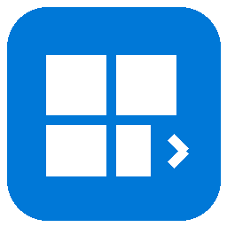
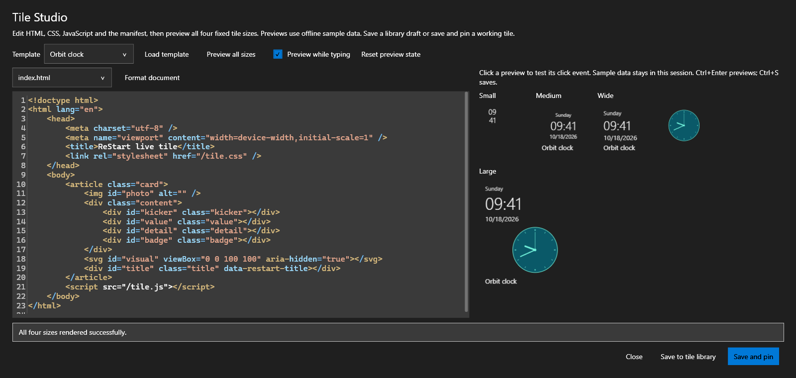
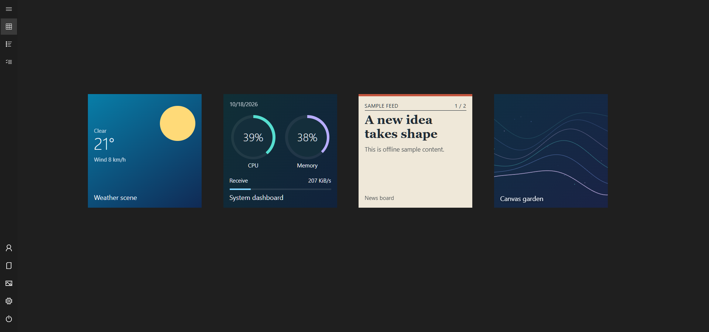
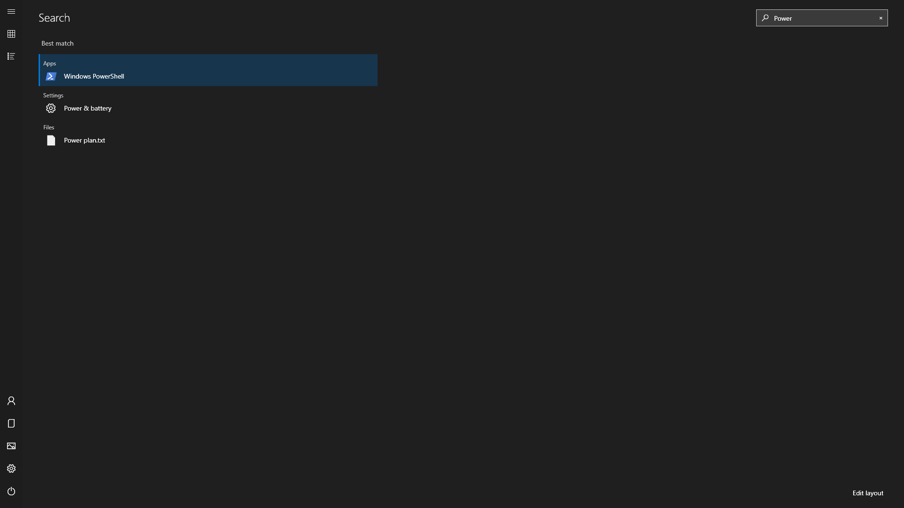
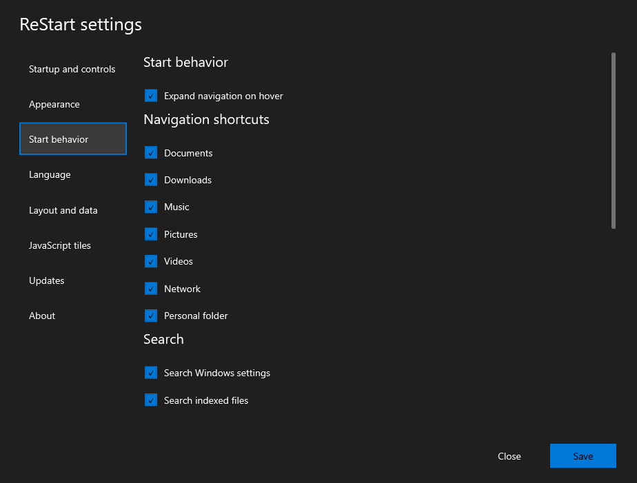
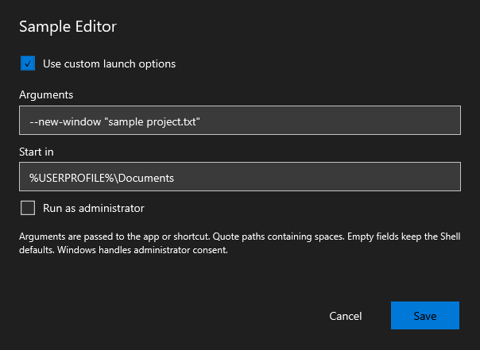
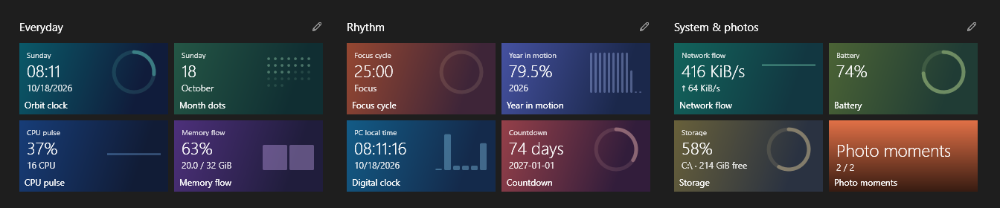

<p align="center"></p>
<h1 align="center">ReStart</h1>
<p align="center"><strong>Retrouvez le menu Démarrer en plein écran.</strong><br>Vos applications, votre disposition, vos propres vignettes dynamiques.</p>

<!-- languages:start -->
<p align="center">
  <a href="README.md">English</a> · <a href="README.de.md">Deutsch</a> · <a href="README.es.md">Español</a> · <a href="README.fr.md">Français</a> · <a href="README.ja.md">日本語</a> · <a href="README.ko.md">한국어</a> · <a href="README.zh-CN.md">简体中文</a> · <a href="README.zh-TW.md">繁體中文</a>
</p>
<!-- languages:end -->

<p align="center"><a href="https://lastresolution.github.io/ReStart/">Site web (en anglais)</a> · <a href="https://lastresolution.github.io/ReStart/developers/">Guide de développement (en anglais)</a></p>

> **Traduction par IA :** ce guide a été traduit de l’anglais à l’aide de l’IA et peut contenir des erreurs. Le [README anglais](README.md) reste la référence principale et contient des exemples supplémentaires. Les corrections sont bienvenues. Les captures utilisent une démonstration en anglais et des données d’exemple.

<p align="center"><strong>Voir la démo de 60 secondes</strong><br><sub>1080p · Anglais · Sans son</sub></p>

https://github.com/user-attachments/assets/243a5c5a-46bc-4180-8a0c-cee71ab63f06

Le menu Démarrer plein écran de Windows 10 vous manque ? ReStart offre un espace familier à vos applications sous Windows 11 et Windows 10. Épinglez vos contenus, organisez l’écran à votre façon et ajoutez des vignettes que vous pouvez écrire en JavaScript.

**Portable · Vignettes JavaScript · x64 et ARM64 · Huit langues · Aucune installation séparée de .NET**

## Plus de contrôle, plus de place pour créer

Verrouillez tout le placement ou certains groupes. Ctrl+Maj+L bascule le verrouillage global. Ctrl+E sélectionne, Ctrl+flèche déplace les tuiles, Ctrl+Maj+flèche leur groupe et Alt+1–4 change la taille. Ctrl+G regroupe la sélection ; Maj+F10 ouvre son menu. Annuler/Rétablir reste disponible. Un fond propre à ReStart peut être enregistré indépendamment du bureau.

Dans **Paramètres → Apparence**, réglez la teinte du fond entre **10 et 100 %** et le flou de l’image entre **0 et 50**. Le flou vaut **12** par défaut ; **0** conserve une image nette. Le contraste élevé est prioritaire. **Terminer la sélection** ou cliquer sur **Vignettes épinglées** ramène directement à la vue des vignettes.

Dix-neuf tuiles HTML/CSS/JavaScript sont incluses. Tile Studio permet de modifier le code et le manifeste, de tester quatre tailles avec des données fictives hors ligne, puis de sauvegarder ou épingler. Nouveaux exemples : scène météo, tableau système, actualités RSS et jardin Canvas. Les aiguilles SVG suivent l’heure du PC. Les noms sont visibles par défaut et peuvent être masqués dans les paramètres.

Pendant le déplacement, une copie semi-transparente de la vignette, du groupe ou de la sélection suit le pointeur. Le repère bleu indique la destination et les vignettes déplacées prévisualisent leur position avant le dépôt.





**Commandes de l’éditeur :** coloration de JavaScript, HTML, CSS et JSON ; **Tab / Maj+Tab** pour l’indentation ; **Format document / Ctrl+Maj+F** pour formater hors ligne avec une seule annulation. Feed headlines et News board défilent dans leur propre tuile. Les dossiers fermés affichent des aperçus animés uniformes. Les dispositions nouvelles ou réinitialisées utilisent Month dots et Orbit clock. La vérification facultative au démarrage signale une nouvelle version par un avis que vous pouvez fermer.

## Démarrage rapide

1. Téléchargez le **[ZIP x64](https://github.com/LastResolution/ReStart/releases/latest/download/ReStart-win-x64.zip)** pour un PC Intel/AMD ou le **[ZIP ARM64](https://github.com/LastResolution/ReStart/releases/latest/download/ReStart-win-arm64.zip)** pour Windows sur ARM.
2. Extrayez **l’intégralité du ZIP**. Conservez `TileHost`, `Examples` et `third-party` à côté de `ReStart.exe`.
3. Lancez **ReStart.exe**, appuyez sur la **touche Windows**, puis saisissez le nom d’une application. **Ctrl+Alt+Espace** et le menu de la zone de notification ouvrent également Démarrer.

La roue dentée permet de régler les thèmes, le lancement à l’ouverture de session, l’intégration de la touche Windows/du bouton Démarrer et les mises à jour. L’usage normal ne nécessite pas de droits administrateur. Les [sommes SHA-256](https://github.com/LastResolution/ReStart/releases/latest) sont fournies.

## Fonctionnalités


| Domaine | Fonctions incluses |
| --- | --- |
| Ouverture et fermeture | Capture facultative de la touche Windows et du bouton Démarrer, Ctrl+Alt+Espace, zone de notification, activation au premier plan, fermeture lors du changement d’application/barre des tâches, zone de travail selon l’écran, instance unique |
| Démarrage | Lancement à la connexion facultatif, mode arrière-plan, écran de préparation adapté au thème avec saisie anticipée, cache d’icônes et actualisation du catalogue |
| Vignettes et groupes | Quatre tailles, épingles indépendantes, groupes rectangulaires déplaçables aux dimensions adaptées au contenu, ancrage horizontal au demi-pas, placement automatique et défilement sur les deux axes |
| Dossiers | Création par superposition dans un groupe, ouverture dans la disposition, ajout/retrait/réorganisation, renommage direct et dissociation ; un enfant unique conserve son dossier |
| Édition | Mode édition, sélection multiple, déplacement collectif, annuler/rétablir pour la session ; l’annulation d’un glissement conserve la disposition |
| Retour pendant le glissement | Cibles de groupe/dossier distinctes, progression d’attente, indications et limites facultatives, défilement aux bords ; création automatique de groupes/dossiers désactivable |
| Épinglage | Applications, fichiers, répertoires, raccourcis et sites ; commande Explorer **Pin to ReStart**, menus contextuels, glissement depuis la liste et destinations explicites |
| Recherche | Noms d’applications normalisés, 15 pages Windows traduites avec alias anglais, noms de fichiers locaux indexés facultatifs, flèches/Entrée, rejet des requêtes périmées |
| Toutes les applications | Colonnes alphabétiques adaptatives, dossiers du menu Démarrer dépliables, choix d’une lettre, clavier, actualisation des installations/suppressions, ajouts récents et applications fréquentes en option |
| Commandes d’application | Actions Windows disponibles : administrateur, emplacement, propriétés, désinstallation ; documents récents/fréquents facultatifs selon les paramètres Windows et les API disponibles |
| Options de lancement | Activation par vignette, arguments, répertoire de travail et élévation pour les applications/raccourcis de bureau compatibles ; Windows gère l’UAC |
| Navigation | Dépliage au survol facultatif, Documents/Téléchargements/Musique/Images/Vidéos/Réseau/dossier personnel sélectionnables, compte et alimentation |
| Apparence | Cinq familles de couleurs avec variantes claires/sombres, mode système, arrière-plan/accent RVB personnalisés, fond d’écran, teinte de Démarrer, couleurs par vignette, contrôles et barres assortis, contraste élevé, animation facultative |
| Vignettes dynamiques | 19 exemples JavaScript, quatre tailles adaptatives, actions locales au clic, mises à jour activables, configuration des données, création d’exemples, import et bibliothèque surveillée automatiquement |
| API de vignette | Heure du PC, langue/taille, état conservé, CPU/mémoire/réseau/batterie/stockage, photos sélectionnées, données JSON/Web API/RSS/Atom/fichiers mises en cache et intégration locale |
| Langues | Anglais, japonais, allemand, français, espagnol, coréen, chinois simplifié et traditionnel, y compris les vignettes fournies |
| Données et mises à jour | Paramètres locaux, import/export/réinitialisation, sauvegardes et migration, historique d’applications effaçable, version/build/licences, vérification sans clé API, mises à jour portables vérifiées avec restauration et rapports de diagnostic |
| Distribution | Paquets portables Windows 10/11 x64 et ARM64 avec runtime et notices ; intégration réversible sans modifier Explorer |

[Options et valeurs par défaut (anglais)](docs/start-behavior.md) · [Compatibilité (anglais)](docs/fidelity.md)

**Une disposition initiale utile.** Au premier lancement et lors d’une réinitialisation, les applications installées sont choisies par fonction à partir de leur identifiant et de leur nom traduit exact. Des tuiles hors ligne fournies, sans doublons, complètent les groupes jusqu’à six tuiles au minimum. Les dispositions enregistrées sont conservées. [Sélection et réinitialisation (anglais)](docs/start-behavior.md#initial-layout-and-reset).

**Couverture mesurée de la plateforme.** Les tests natifs vérifient le placement des fenêtres sur deux écrans à 100 %/125 %/150 %, y compris en orientations portrait et paysage combinées. Les fournisseurs d’accessibilité sont contrôlés dans huit langues et les deux thèmes ; les annonces de base de Narrator ont été examinées dans le récapitulatif vocal. La reconnexion des écrans, le tactile physique et les parcours complets avec lecteur d’écran nécessitent d’autres tests sur appareils. [Résultats et appareils (anglais)](docs/fidelity.md#observed-platform-coverage).

## Rechercher et configurer



Dans **Settings → Start behavior**, désactivez séparément la recherche de paramètres/fichiers, les menus de documents, les effets de survol, les groupes/dossiers automatiques, le défilement aux bords et les indications. L’enregistrement des applications fréquentes est désactivé par défaut.

| Comportement | Lancement par vignette |
| --- | --- |
|  |  |

**Use custom launch options** peut être désactivé sans effacer les champs. Sinon, les raccourcis conservent leur comportement Windows habituel.

## Vignettes et données personnelles



- **Heure et concentration :** Orbit clock, Digital clock, Month dots, Focus cycle, Year in motion et Countdown.
- **PC :** CPU pulse, Memory flow, Network flow, Battery et Storage.
- **Photos :** Photo moments, avec un dossier choisi et passage à l’image suivante au clic.
- **Connexions :** Weather, Feed headlines et JSON monitor.

Clic droit sur l’arrière-plan → **Add live tile**. Un clic agit dans la vignette : pause du minuteur, photo suivante, etc. Pour Weather/Feed/JSON, ouvrez **Configure data sources…**, indiquez une URL ou un fichier et enregistrez. **Refresh data now** demande une nouvelle valeur.

**La météo utilise Berlin comme exemple initial, pas votre position.** ReStart ne déduit pas votre région. Modifiez les coordonnées et le nom du lieu avec le [guide météo](docs/javascript-tiles.md#weather-location). Les identifiants sont chiffrés pour votre utilisateur Windows et exclus des exports. Le cache reste utilisable lors d’une panne ; masquer Démarrer interrompt les lectures.

Une tuile web contient manifest.json, index.html, tile.css, tile.js et des assets facultatifs. HTML/CSS, SVG, Canvas et transparence sont libres dans les quatre tailles fixes. Les anciens paquets JS natifs restent compatibles. WebView2 Runtime est requis. Le réseau direct nécessite une capacité déclarée et une autorisation individuelle ; aucune passerelle générale vers les fichiers, CLR ou le shell n’est exposée. [HTML/CSS/JavaScript API](docs/javascript-tiles.md) · [Examples](examples/tiles)

## Commandes usuelles

| Action | Résultat |
| --- | --- |
| Touche Windows / `Ctrl+Alt+Space` | Ouvrir ou fermer |
| Saisir / `Ctrl+F` | Rechercher ; Entrée lance le résultat surligné, les flèches changent la sélection |
| `Esc` | Fermer la recherche, le dossier ou la surcouche, puis Démarrer |
| Glisser une vignette / un titre de groupe | Déplacer ; un espace vide crée une épingle indépendante |
| Superposer une vignette indépendante environ 0,3 s | Créer un groupe lorsque l’aperçu est prêt |
| Superposer une vignette d’un groupe environ 0,6 s | Créer un dossier ; les dossiers existants acceptent des ajouts |
| **Sélectionner des vignettes** dans la barre latérale/le menu du fond / `Ctrl+E` | Sélection multiple sans ouvrir d’applications ; le déplacement direct reste disponible |
| `Ctrl+A` / `Delete` en édition | Sélectionner les vignettes racines / détacher la sélection |
| `Ctrl+Z` / `Ctrl+Y` ou `Ctrl+Shift+Z` | Annuler / rétablir la disposition |
| Crayon / double-clic sur un nom | Renommer directement le groupe ou dossier |
| `Shift` + molette | Défiler horizontalement |

Les raccourcis Windows sont transmis au système. L’historique conserve jusqu’à 100 modifications dans une limite de 32 Mio pendant la session ; les champs de texte gardent leur propre annulation. La réouverture retourne aux vignettes épinglées.

## Paramètres, confidentialité et mises à jour

Paramètres : `%LOCALAPPDATA%\ReStart\layout.json`. L’activité facultative est séparée dans `activity.json` et peut être effacée. Les migrations gardent des sauvegardes ; [détails (anglais)](docs/migration.md). About affiche version, build et licences.

Les mises à jour consultent les GitHub Releases publiques sans clé API. Dans Paramètres → Mises à jour, choisissez **Télécharger la mise à jour**, puis **Redémarrer et mettre à jour**. Les paquets portables complets et non modifiés, dans un dossier accessible en écriture, permettent une mise à jour vérifiée avec restauration en cas d’échec de l’installation ou du démarrage. Les anciens paquets et versions de développement restent remplaçables manuellement. À propos → Informations de diagnostic permet de vérifier et copier un rapport sans chemins, listes d’applications, données de tuiles, identifiants ni journaux bruts. Rien n’est envoyé automatiquement. [Mises à jour et diagnostic (anglais)](docs/updates.md). Si son emplacement change, réenregistrez le démarrage et l’intégration Explorer. Aucune publicité ni analyse d’usage ; listes d’applications, dispositions et choix de photos ne sont pas téléversés. Les fournisseurs de données configurés reçoivent leurs requêtes. [Sécurité (anglais)](SECURITY.md)

Pour désinstaller : désactivez le lancement à la connexion et l’intégration Explorer, quittez via la zone de notification et supprimez le dossier d’installation. Supprimez les données locales uniquement pour effacer aussi paramètres et vignettes personnelles.

## Compiler

Utilisez Windows et le [SDK .NET 10 stable](https://dotnet.microsoft.com/download/dotnet/10.0) indiqué dans `global.json`. Fermez l’application avant de remplacer ses fichiers.

```powershell
git clone https://github.com/LastResolution/ReStart.git
cd ReStart
dotnet restore ReStart.slnx --locked-mode
dotnet build ReStart.slnx -c Release --no-restore
dotnet test ReStart.slnx -c Release --no-build
.\src\ReStart.App\bin\Release\net10.0-windows\ReStart.exe
# Aperçu isolé :
dotnet run --project src/ReStart.App -c Release -- --preview
# Paquet portable avec runtime :
./scripts/package.ps1 -Runtime win-x64
```

Pour ARM64, utilisez `win-arm64`. ZIP et sommes de contrôle sont dans `artifacts/packages`. Distribuez toujours le ZIP complet.

[Bugs et idées](https://github.com/LastResolution/ReStart/issues/new/choose) · [Contribuer (anglais)](CONTRIBUTING.md) · [Architecture (anglais)](docs/architecture.md) · [Tests (anglais)](docs/testing.md) · [Versions](https://github.com/LastResolution/ReStart/releases)

ReStart est un projet MIT indépendant, inspiré du menu Démarrer plein écran des dernières versions de Windows 10 et non affilié à Microsoft. Captures et animation montrent la vraie application avec une démonstration anglaise, des mesures synthétiques et des couleurs de photos générées. Noms et icônes appartiennent à leurs propriétaires. [Licence MIT](LICENSE) · [Mentions tierces (anglais)](docs/third-party.md) · [Assistance (anglais)](SUPPORT.md)

---

<!-- support:start -->
<h2 align="center">Soutenir le développement indépendant</h2>
<p align="center">
  ReStart vous plaît ? Aidez LastResolution à créer et améliorer des outils utiles, pour ReStart et les projets à venir.<br>
  <sub>ReStart est gratuit et open source. Le soutien reste entièrement facultatif.</sub>
</p>
<p align="center">
  <a href="https://buymeacoffee.com/LastResolution"></a>
</p>
<!-- support:end -->
