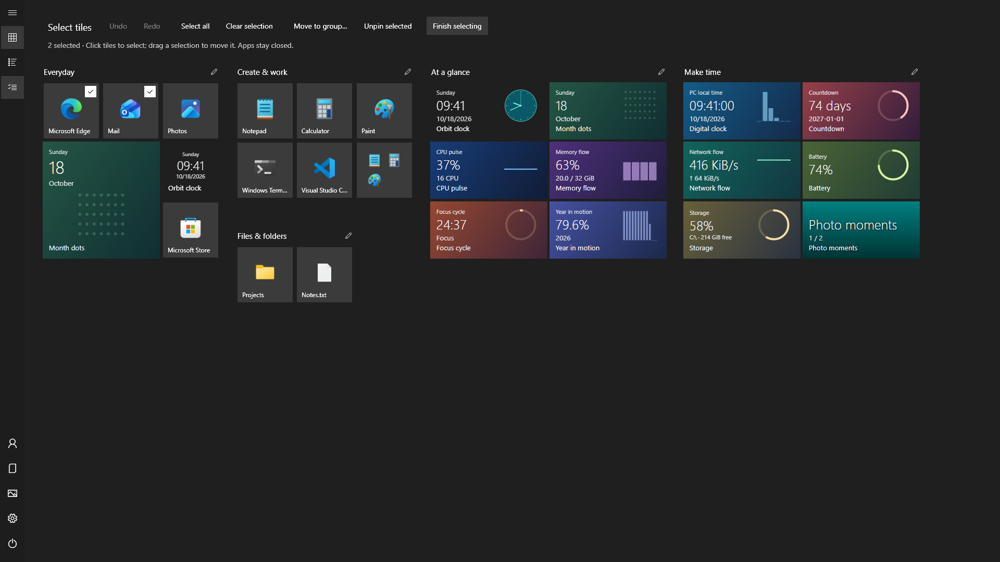
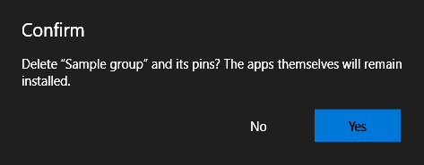
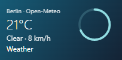
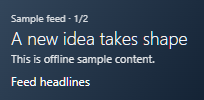
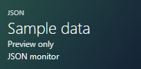

<p align="center"></p>
<h1 align="center">ReStart</h1>
<p align="center"><strong>Bring full-screen Start back.</strong><br>Your apps, your layout, your own live tiles.</p>
<p align="center">
  <a href="https://github.com/LastResolution/ReStart/releases/latest/download/ReStart-win-x64.zip"><strong>Download for Windows · x64</strong></a> ·
  <a href="https://github.com/LastResolution/ReStart/releases/latest/download/ReStart-win-arm64.zip">ARM64</a> ·
  <a href="https://github.com/LastResolution/ReStart/releases/latest">Release notes</a>
</p>
<p align="center">
  <a href="https://github.com/LastResolution/ReStart/actions/workflows/ci.yml"></a>
  <a href="https://github.com/LastResolution/ReStart/releases/latest"></a>
  <a href="LICENSE"></a>
</p>

<!-- languages:start -->
<p align="center">
  <a href="README.md">English</a> · <a href="README.de.md">Deutsch</a> · <a href="README.es.md">Español</a> · <a href="README.fr.md">Français</a> · <a href="README.ja.md">日本語</a> · <a href="README.ko.md">한국어</a> · <a href="README.zh-CN.md">简体中文</a> · <a href="README.zh-TW.md">繁體中文</a>
</p>
<!-- languages:end -->

<p align="center"><a href="https://lastresolution.github.io/ReStart/">Website</a> · <a href="https://lastresolution.github.io/ReStart/developers/">Developer guide</a></p>

English is the primary documentation. The translated guides are AI-assisted and may contain errors; corrections are welcome. All screenshots use an English demonstration environment.

<p align="center"><strong>Watch the 60-second demo</strong><br><sub>1080p · English · No audio</sub></p>

https://github.com/user-attachments/assets/a893cd20-8c82-4c47-b5fb-bf22743f67e1

**Miss the Windows 10 full-screen Start menu?** ReStart gives your apps a familiar home on Windows 11 and Windows 10. Pin what you use, arrange the screen your way, and add live tiles that you can build with HTML, CSS and JavaScript.

**Portable · HTML/CSS/JavaScript live tiles · x64 & ARM64 · Eight languages · No separate .NET installation**

[Explore the tiles](#give-your-tiles-something-to-say) · [Connect your data](#connect-weather-headlines-and-app-data) · [Write a tile](#write-your-own) · [Build from source](#build-it-yourself)

**Touch and taskbar.** Touch supports tile and group dragging, long-press menus, folders and scrolling. Startup settings can show an automatically hidden taskbar on ReStart’s display while it is open. Windows controls automatic hiding; ReStart has no separate hide option. Host data connections require **Save and approve** for each placed tile. Changed access requests need approval again. [Behavior and measured coverage](docs/fidelity.md).

## Reliability and private backups

Live tiles pause outside the visible area and recover from browser failures with bounded retries. Both behaviors have independent switches in JavaScript tile settings. **Settings → Layout and data** can back up and restore layout, appearance, installed tiles, library drafts and backgrounds together. Saved data connections, credentials, photo-folder paths and caches are excluded; backups still contain private app names, launch paths and your custom source/assets. [Backup and recovery guide](docs/backups.md).

## Start in a minute

1. Download the **[x64 ZIP](https://github.com/LastResolution/ReStart/releases/latest/download/ReStart-win-x64.zip)** for an Intel/AMD PC, or the **[ARM64 ZIP](https://github.com/LastResolution/ReStart/releases/latest/download/ReStart-win-arm64.zip)** for Windows on ARM.
2. Extract the **entire ZIP** into a folder you want to keep. Leave `TileHost`, `Examples`, `third-party` and `ReStart-package.json` beside `ReStart.exe`.
3. Run **ReStart.exe**. Press the **Windows key**, then type an app name to search. <kbd>Ctrl</kbd> + <kbd>Alt</kbd> + <kbd>Space</kbd> and the tray menu also open Start.

Use the gear icon for themes, optional sign-in startup, Windows-key/Start-button integration and updates. Normal use needs no administrator rights. Checksums are included on the [release page](https://github.com/LastResolution/ReStart/releases/latest).

## A familiar place to begin


- **Make room for your apps.** Four tile sizes, movable groups, optional independent tiles and folders that expand in place. Drag, resize and rename without leaving Start. A translucent copy follows the pointer for tiles, groups and selections. Ordinary moves preview displaced tiles before you drop; cancellation restores the original positions.

- **Choose several tiles without accidental launches.** Use **Select tiles** in the sidebar or background context menu, or press <kbd>Ctrl</kbd> + <kbd>E</kbd>. Move a selection together, then undo or redo the whole operation. Individual tiles and groups can be dragged directly while unlocked. Global and per-group placement locks prevent accidental changes; Ctrl+Arrow moves selected tiles without a mouse.
- **Keep your files close.** Pin a document, directory or shortcut from Explorer's **Pin to ReStart** command.
- **Find the next thing.** Search apps, 63 Windows settings pages and indexed local files, with optional indexed-content matching. App menus can show recent/frequent documents, Windows-pinned destinations and registered application tasks. Choose sidebar folders, optional app history and per-tile launch options. Control each feature in **Settings → Start behavior**. [Explore the switches](docs/start-behavior.md).
- **Open and type.** The first launch prepares icons and live tiles behind a localized progress screen with the app logo. Keystrokes typed while loading carry into Start automatically. Enter launches the highlighted search result; reopening returns to your pinned home. Installed and removed apps refresh in the background while ReStart keeps running.
- **Set the mood.** Choose Midnight, Ocean, Forest, Rose or Sand independently of light, dark or system mode: every family has both variants. Entering your own background or accent switches to exact custom RGB colors. Text, controls, both scrollbars and the splash adapt together. Light, dark, system and high contrast remain available; wallpaper, individual tile colors and animation are optional.

**Groups by default, freedom when you need it.** Drop into empty space to create an unnamed group; overlap a tile and wait to make a folder. Hold <kbd>Shift</kbd> while dragging to rearrange without folders, or <kbd>Alt</kbd> to place independently in empty space. Settings → Start behavior → **Use free tile placement** makes independent placement the default. Existing layouts and folders are preserved. Neighboring tiles ease into place without changing the recipient under your pointer.

Drag shortcut tips appear briefly at the bottom of Start and can be disabled in Start behavior settings. Press <kbd>F1</kbd>, or open **Keyboard shortcuts** in those settings, for the complete reference.

<details>
<summary><strong>See the light theme</strong></summary>


</details>

## Windows app integration

Search now also uses Windows-provided settings keywords and Control Panel entries. Optional Advanced Query Syntax adds native file filtering and relevance order. **Open Windows Search** opens the Windows interface with <kbd>Win</kbd> + <kbd>S</kbd>; enter your query there for additional sources.

Two options are off by default: counts of app launches recorded by Windows for Most used, and a read-only compatibility reader for Windows app tiles and badges. The tile renderer supports common size bindings, local raster images and literal data bindings. It does not restore discontinued push services; unavailable data keeps the app icon.

[Settings and compatibility details](docs/start-behavior.md) · [Coverage](docs/fidelity.md)

## More control, more room to create

- **Protect your layout:** lock every placement or one group. Use <kbd>Ctrl</kbd> + <kbd>Shift</kbd> + <kbd>L</kbd> for the global lock.
- **Edit with the keyboard:** <kbd>Ctrl</kbd> + <kbd>E</kbd> selects tiles, arrows choose one, <kbd>Ctrl</kbd> + <kbd>Arrow</kbd> moves it, <kbd>Ctrl</kbd> + <kbd>Shift</kbd> + <kbd>Arrow</kbd> moves its group, and <kbd>Alt</kbd> + <kbd>1–4</kbd> changes its size. <kbd>Ctrl</kbd> + <kbd>G</kbd> groups a selection; <kbd>Shift</kbd> + <kbd>F10</kbd> opens its menu. Undo/redo remains available.
- **Choose a separate background:** keep the desktop wallpaper or import an image just for ReStart. The app stores its own decoded copy, without keeping the original source path.
- **Create in Tile Studio:** HTML, CSS, browser JavaScript, all four size previews and offline sample input. Nineteen bundled examples provide a starting point.
- **Keep the names you want:** live tile names are shown by default and can be hidden in settings. Tooltips and accessibility names remain available.

In **Settings → Appearance**, adjust background tint from **10–100%** and wallpaper blur from **0–50**. Blur defaults to **12**; choose **0** for a sharp image. High contrast overrides these effects. **Finish selecting**, or clicking **Pinned tiles**, returns directly to the pinned home screen.

Preview appearance, tile scale, group width and language before saving. Closing with changes offers **Save and close**, **Discard and close**, or **Keep editing**; discarding restores the committed presentation. After an explicit update download, a persistent ready indicator offers restart. The verified preparation is recovered on the next launch; ordinary launches never install it automatically.


## Everything at a glance

| Area | Included features |
| --- | --- |
| Open and close | Optional Windows-key and taskbar Start-button capture, Ctrl+Alt+Space, tray controls, foreground activation, close on app/taskbar switching, monitor-aware working area and a single running instance |
| Startup | Optional sign-in startup, silent background mode, a themed preparation screen with typeahead, icon caching and background catalog refresh |
| Tiles and groups | Small, medium, wide and large tiles; unnamed groups by default, optional independent pins; movable rectangular groups with content-sized bounds; half-cell horizontal anchors; automatic placement and scrolling in both directions |
| Folders | Create by sustained overlap, open inline, add/remove/reorder children, rename inline and unpack; one remaining child keeps its folder |
| Layout editing | Global/per-group placement locks, keyboard placement/resize/group moves, edit mode, multi-selection and session Undo/Redo; cancelled drags preserve the original layout |
| Drag feedback | Distinct group/folder/drop destinations, dwell progress, optional hints, hover boundaries and stationary edge scrolling; automatic group/folder creation can be switched off |
| Pin anything | Apps, files, directories, shortcuts and websites; Explorer's Pin to ReStart, app/search context menus, drag from app lists, and explicit destinations |
| Search | App names, executable aliases, 63 translated settings fallbacks plus Windows-provided keywords/Control Panel, bounded indexed files, opt-in content and native AQS, retained selection and an explicit Windows Search handoff |
| Windows session | Switch user through Windows sign-in; policy/capability-aware Sleep and Hibernate, Shut down/Restart, and Windows Update completion actions when a restart is required |
| All apps | Responsive columns with Windows language-specific alphabetical headings (including kana, Hangul, pinyin and stroke counts), Start-menu directory expansion, scrollable letter picker, Unicode initial-key navigation, live installation/removal refresh, optional Recently added and opt-in Most used |
| App commands | Context-aware menus: Start actions under More, direct search actions, file/folder location, package management/review and available Windows verbs. Optional Recent/Frequent documents, Windows-synchronized Jump List pins and registered application Tasks have their own actions. Pin/unpin documents from their menus; app-history removal and navigation customization are also available. See the [menu guide and Windows 10 coverage](docs/context-menus.md). File Share is limited to accessible files on supported Windows systems; Properties requires an existing file, folder or source shortcut. Unsupported actions are omitted. Application-defined Jump List categories retain their registered labels and original actions. |
| Launch options | Per-tile enable/disable, additional arguments, working directory and administrator execution for supported desktop apps/shortcuts; Windows handles UAC |
| Navigation | Optional hover expansion; individually selectable Documents, Downloads, Music, Pictures, Videos, Network and Personal folder; Windows account picture, account and power actions |
| Appearance | Five color families in light/dark/system modes, custom background/accent RGB, desktop or separate locally stored wallpaper, Start accent tint, classic or individual tile colors, themed controls/scrollbars, high contrast and optional motion |
| Live tiles | Nineteen bundled HTML/CSS/JavaScript tiles, four responsive sizes, local click actions, live updates on/off, per-tile data configuration, Tile Studio, optional bottom names, package import and an automatically watched local tile library |
| Tile APIs | PC-local time, language and size, retained state, CPU/memory/network/battery/storage metrics, selected photo slideshows, cached JSON/Web API/RSS/Atom/local-file inputs and local application integration |
| Language | English, Japanese, German, French, Spanish, Korean, Simplified Chinese and Traditional Chinese, including bundled tile text |
| Data and updates | Local settings, layout import/export/reset, backup and version migration, clearable local app activity, version/build/license information and API-key-free checks, explicit verified portable updates with rollback, and previewable diagnostic reports |
| Distribution | Portable Windows 10/11 x64 and ARM64 packages, included runtime/notices, no administrator requirement for normal use and reversible integration without Explorer patching |

[Feature switches and defaults](docs/start-behavior.md) · [Detailed controls](#everyday-details) · [Compatibility and platform coverage](docs/fidelity.md) · [JavaScript API](docs/javascript-tiles.md)

**A useful first layout.** Initial and reset layouts choose installed apps by role, using app identities and exact translated names. Distinct offline bundled tiles fill sparse groups to at least six tiles each. Existing saved layouts are preserved. [Selection and reset behavior](docs/start-behavior.md#initial-layout-and-reset).

**Measured platform coverage.** Native window-placement checks cover two displays at 100%/125%/150% scaling, including mixed portrait/landscape. Accessibility providers are checked in eight languages and both themes; basic Narrator announcements were inspected through Speech recap. Touch taps, long-press menus, tile/group dragging, folder creation and scrolling were checked in an isolated fixture. Display reconnects, remaining touch scenarios and full screen-reader interaction still need device checks. [Results and device coverage](docs/fidelity.md#observed-platform-coverage).

### Search, configure, launch

Find apps by their displayed name or a Windows-supplied executable name: for example, `notepad` or `cmd` can find the corresponding installed app even when its name is translated. Search uses Start-menu targets, matching App Paths registrations and package-declared execution aliases. Availability depends on installed metadata; this is ReStart's local ranking, not Windows Search's complete results. Shortcuts with launch arguments rank below the ordinary app for a shared executable name.

**Web and cloud.** Choose **Search the web for…** to open the current query in Bing using your default browser. **Search Windows and cloud** opens Windows Search; enter your query there, with cloud availability controlled by Windows and connected accounts. Typing alone sends nothing externally. Both actions can be switched off.

Use <kbd>↑</kbd>/<kbd>↓</kbd> or <kbd>Tab</kbd>/<kbd>Shift</kbd>+<kbd>Tab</kbd> to select local, Web or Windows/cloud actions; <kbd>Enter</kbd> invokes the selected row. When local searches finish without a match, an enabled online action is highlighted for Enter. Typing alone never opens it.

**App history.** Enabled Most used history can sort equally strong app matches; exact names and executable aliases keep priority. Recently added starts with three entries and offers **Show more / Show less**. Windows shortcut history exclusions are respected. Windows Start’s private ranking and installation history are not duplicated; see [behavior and limits](docs/start-behavior.md#app-and-document-history).


<details>
<summary><strong>Choose your behavior and app launch options</strong></summary>

| Start behavior | Per-tile launch options |
| --- | --- |
|  |  |






Switch off settings/file search, document history, application tasks, custom Jump List categories, Windows-pinned destinations, hover effects, automatic overlap grouping/folders, edge scrolling or drop hints individually. Most used recording starts off. **Use custom launch options** can be disabled while retaining its fields. The screenshots use fictional apps and documents.

</details>

## Give your tiles something to say

See the time, PC activity, your chosen photos, weather and headlines alongside your apps. **Nineteen HTML/CSS/JavaScript tiles are included**, with layouts for all four tile sizes.


- **Time and focus:** Orbit clock, Digital clock, Month dots, Focus cycle, Year in motion and Countdown.
- **Your PC:** CPU pulse, Memory flow, Network flow, Battery and Storage.
- **Your photos:** Photo moments, with a folder you choose and click-to-advance slides.

Right-click the background → **Add live tile** to try one. Click a tile to use its local action, such as pausing a focus timer or advancing a photo.

### Connect weather, headlines and app data

<p align="center">  </p>

| Tile | What it shows | Choose your source |
| --- | --- | --- |
| **Weather** | Temperature, conditions and wind from Open-Meteo | Set the coordinates for a place you want to follow |
| **Feed headlines** | RSS/Atom headlines; click to see the next item | Paste a feed URL |
| **JSON monitor** | Service status, a value or progress from your own app | Use a Web API, localhost endpoint or selected JSON file |

1. Right-click the background → **Add live tile** → choose one of these three tiles.
2. In **Configure data sources…**, enter the address or choose a local file, then **Save**. Optional credentials belong in this dialog.
3. To change an installed tile's connection, right-click it → **Configure data sources…**. **Refresh data now** requests a fresh value.

Updates run asynchronously while Start is opening or visible. Cached values stay useful during connection failures, and hiding Start stops reads. Connections and credentials are encrypted for your Windows user and excluded from shared layouts; importing a package alone does not connect it.

**Weather starts with Berlin example coordinates, not your PC's location.** ReStart does not infer your region. The [location guide](docs/javascript-tiles.md#weather-location) explains how to change the coordinates and displayed place name. The image above uses fictional local data.

For your own application, publish JSON through an existing local endpoint or a file. The [file-producer example](examples/integrations/write-tile-data.ps1) and [data-source guide](docs/javascript-tiles.md#weather-feeds-web-apis-and-application-data) show both routes, selectors and credential settings.

### Write your own

A web tile contains `manifest.json`, `index.html`, `tile.css` and `tile.js`, plus optional local assets. Use ordinary HTML/CSS, SVG and Canvas inside the four fixed tile footprints. Transparent backgrounds and circular designs are supported; legacy native JavaScript packages still work.

Open **Tile Studio** from settings or the tile menu. Edit the source, preview all four sizes with offline sample data, test click actions, then save a draft or save and pin. Installed-tile edits keep the package ID, placement and local connection bindings.

**Editor controls:** syntax highlighting for JavaScript, HTML, CSS and JSON; <kbd>Tab</kbd> / <kbd>Shift</kbd> + <kbd>Tab</kbd> for indentation; **Format document / Ctrl+Shift+F** for offline formatting with one-step undo. Feed headlines and News board scroll within their own tile. Closed folders show uniformly sized live previews. New and reset layouts use the included Month dots and Orbit clock. Optional startup checks show a dismissible notice when a newer release is available.

```json
{ "version": 2, "renderer": "web", "title": "My tile", "refreshSeconds": 1 }
```

```html
<main><strong id="value"></strong><span data-restart-title id="name"></span></main>
<script src="/tile.js"></script>
```

```js
function render(ctx) {
  document.getElementById("value").textContent =
    new Date(ctx.now).toLocaleTimeString(ctx.locale);
  document.getElementById("name").textContent = ctx.title;
}
```

Style the markup in `tile.css`; respond to `data-size`, `ctx.bounds`, language and theme. Add a package folder to `%LOCALAPPDATA%\ReStart\TileLibrary` to make it appear in the gallery. The [tile guide](docs/javascript-tiles.md) covers the complete package, browser API, explicit data connections, networking permission and execution boundaries. HTML tiles use Microsoft's WebView2 Runtime; a missing runtime produces setup guidance. No Node.js or OS/filesystem bridge is exposed.

The **Weather scene**, **System dashboard**, **News board** and **Canvas garden** samples demonstrate CSS weather artwork, multiple real PC gauges, RSS typography and animated Canvas art. The SVG Orbit clock keeps its hands current from the PC clock between host refreshes. All nineteen packages include localized text and responsive layouts. **Show live tile names** starts on; turn it off in settings for a cleaner tile surface. Animations respect reduced motion.

## Make it yours—and share it

The interface and bundled tiles support **English, Japanese, German, French, Spanish, Korean, Simplified Chinese and Traditional Chinese**.

Have a question, a layout to show, or an idea for a tile? [Join Discussions](https://github.com/LastResolution/ReStart/discussions); the [getting-started FAQ](https://github.com/LastResolution/ReStart/discussions/30) covers common questions. For reproducible bugs, [open an issue](https://github.com/LastResolution/ReStart/issues/new/choose). Contributions to tiles, translations, accessibility and launcher behavior are welcome. The [contribution guide](CONTRIBUTING.md) explains how to get started.

## Everyday details

<details>
<summary><strong>Keyboard and mouse controls</strong></summary>

| Action | Result |
| --- | --- |
| Bare Windows key / <kbd>Ctrl</kbd> + <kbd>Alt</kbd> + <kbd>Space</kbd> | Open or close |
| Type / <kbd>Ctrl</kbd> + <kbd>F</kbd> | Search apps, enabled settings and indexed filenames |
| <kbd>Enter</kbd> in search | Launch the highlighted result; use `↓` / `↑` to change it |
| <kbd>Esc</kbd> | Close the current search, folder or overlay, then Start |
| <kbd>Tab</kbd> / arrows / <kbd>Enter</kbd> | Navigate and activate |
| Drag a tile / group header | Move it |
| Drop a tile in empty space | Create an unnamed group |
| <kbd>Alt</kbd> + drag into empty space | Place independently for this drag |
| <kbd>Shift</kbd> + drag | Rearrange and displace neighbors without overlap grouping or folder actions |
| Overlap a tile for about 0.6 seconds, then drop when the folder preview is ready | Create a tile folder; an existing folder accepts children |
| **Select tiles** in the sidebar/background menu / <kbd>Ctrl</kbd> + <kbd>E</kbd> | Select several tiles without launching apps; normal dragging remains available outside this mode |
| <kbd>Ctrl</kbd> + <kbd>A</kbd> / <kbd>Delete</kbd> in edit mode | Select root tiles / unpin the selection |
| <kbd>Ctrl</kbd> + <kbd>Z</kbd> / <kbd>Ctrl</kbd> + <kbd>Y</kbd> or <kbd>Ctrl</kbd> + <kbd>Shift</kbd> + <kbd>Z</kbd> | Undo / redo a layout edit; text fields keep their own text undo |
| Pencil button / double-click a group or folder name | Rename inline |
| Right-click an app, tile or background | Pin, resize, add tiles and more |
| <kbd>Shift</kbd> + mouse wheel | Scroll horizontally |

Win+letter shortcuts are forwarded to Windows. Settings can disable Windows-key and taskbar Start-button capture. [Compatibility](docs/fidelity.md) describes the desktop integration and platform coverage.

Selection mode provides **Move to group…**, **Unpin selected** and **Finish selecting**. Finishing selection returns directly to the pinned home screen; clicking **Pinned tiles** also leaves selection mode. Dragging keeps relative positions; the group menu collects the selection into a compact block. A sustained overlap can create a folder from a tile or selection, or add to an existing folder. Optional free-mode overlap grouping collects independent tiles into an ordinary group. Hold <kbd>Shift</kbd> while dragging to suppress overlap actions. Use a folder's **Open folder** context action to arrange its children. A folder with one remaining child stays a folder; removing its last child removes the folder. <kbd>Esc</kbd> clears selection, then leaves editing. Reopening Start leaves edit mode. Layout history lasts for the running session (up to 100 edits within a 32 MiB memory budget); it preserves current preferences and is never saved to disk. Each successful pin, move, resize, rename, color change, folder edit, import or reset is undoable as one operation.

</details>

<details>
<summary><strong>Settings, privacy and updating</strong></summary>

Settings live in `%LOCALAPPDATA%\ReStart\layout.json`. Saves and upgrades retain backups; see [migration and rollback](docs/migration.md). About displays the running version/build and licenses.

Optional app activity is stored separately in `activity.json` and can be cleared in Start behavior. Document-history menus respect the Windows setting. File search uses the Windows index and can be disabled independently. [Settings and data details](docs/start-behavior.md).

Update checks read public GitHub Releases without an API key. In Settings → Updates, choose **Download update**, then **Restart and update** after verification. Guided updates require a complete, unmodified portable package in a writable folder and restore the previous files if installation or startup fails. Developer builds and older packages can still be replaced manually. Settings → About → **Diagnostic information** previews a report you can copy without paths, app lists, tile data, credentials or raw logs. Nothing is uploaded automatically. See [updates and diagnostics](docs/updates.md).

No advertising or usage analytics are included. App lists, layouts and photo-folder selections are not uploaded. Native JavaScript tiles return bounded display data; web tiles use sandboxed browser DOM/CSS/Canvas with explicitly permitted networking. Neither receives a general filesystem, CLR or shell bridge. Configured data providers receive their requests and explicitly configured parameters/credentials; see [security](SECURITY.md).

To uninstall, disable sign-in startup and Explorer integration, exit the tray app and delete the extracted installation. Remove the local data folder only if you also want to delete your settings and custom tiles.

</details>

## Build it yourself

<details>
<summary><strong>Release build and portable packaging commands</strong></summary>

Use Windows and the stable [.NET 10 SDK](https://dotnet.microsoft.com/download/dotnet/10.0) selected by `global.json`. Exit the app if its output files are in use.

~~~powershell
git clone https://github.com/LastResolution/ReStart.git
cd ReStart
dotnet restore ReStart.slnx --locked-mode
dotnet build ReStart.slnx -c Release --no-restore
dotnet test ReStart.slnx -c Release --no-build
.\src\ReStart.App\bin\Release\net10.0-windows\ReStart.exe
~~~

This is a framework-dependent developer build. Use isolated preview mode to avoid hooks, real settings, startup registration, update requests and credential changes:

~~~powershell
dotnet run --project src/ReStart.App -c Release -- --preview
./scripts/smoke.ps1
~~~

Create self-contained portable packages and SHA-256 files with:

~~~powershell
./scripts/package.ps1 -Runtime win-x64
# ./scripts/package.ps1 -Runtime win-arm64
~~~

Output: `artifacts/packages/ReStart-win-x64.zip` or `ReStart-win-arm64.zip`. Always distribute and extract the entire ZIP. Generated artifacts and preview data are ignored by Git.

</details>

[Architecture](docs/architecture.md) · [Testing](docs/testing.md) · [Releasing](docs/releasing.md) · [Branch protection](docs/github-protection.md)

## About the project

ReStart is an independent, MIT-licensed project inspired by late Windows 10 full-screen Start. It uses reversible desktop integration and does not patch Explorer. It is not affiliated with Microsoft. Read [compatibility](docs/fidelity.md) for implemented behavior, differences and platform testing.

Screenshots, animation and the video show the real launcher with an isolated English demonstration layout, curated app names, synthetic metrics and generated photo colors. They do not show a user's app inventory, personal documents or location. Application icons are obtained from installed apps without changing their names in the real catalog. Windows/application names and icons belong to their owners. Dependency and .NET notices ship with the app.

[MIT license](LICENSE) · [Third-party notices](docs/third-party.md) · [Security policy](SECURITY.md) · [Support](SUPPORT.md)

---

<!-- support:start -->
<h2 align="center">Support independent development</h2>
<p align="center">
  Enjoy ReStart? Help LastResolution build and improve useful tools, including ReStart and future projects.<br>
  <sub>ReStart is free and open source. Support is always optional.</sub>
</p>
<p align="center">
  <a href="https://buymeacoffee.com/LastResolution"></a>
</p>
<!-- support:end -->
