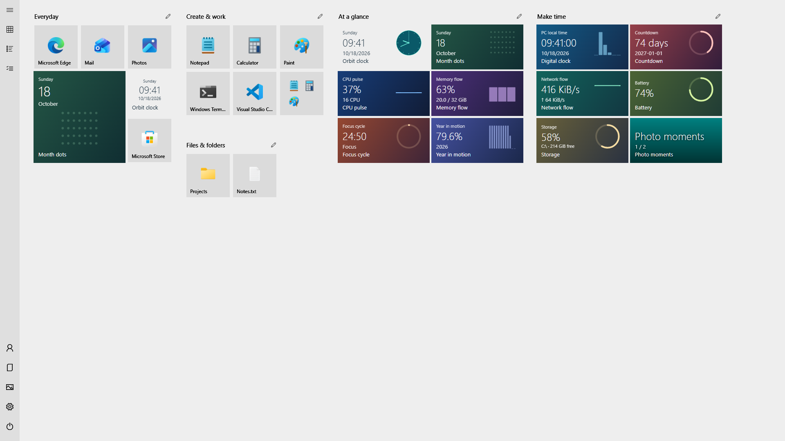
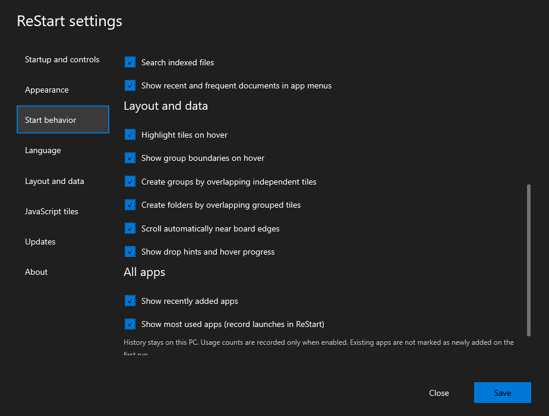
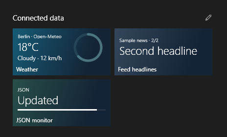

<p align="center"></p>
<h1 align="center">ReStart</h1>
<p align="center"><strong>Bring full-screen Start back.</strong><br>Your apps, your layout, your own live tiles.</p>
<p align="center">
  <a href="https://github.com/LastResolution/ReStart/releases/latest/download/ReStart-win-x64.zip"><strong>Download for Windows · x64</strong></a> ·
  <a href="https://github.com/LastResolution/ReStart/releases/latest/download/ReStart-win-arm64.zip">ARM64</a> ·
  <a href="https://github.com/LastResolution/ReStart/releases/latest">Release notes</a>
</p>
<p align="center">
  <a href="https://github.com/LastResolution/ReStart/actions/workflows/ci.yml"></a>
  <a href="https://github.com/LastResolution/ReStart/releases/latest"></a>
  <a href="LICENSE"></a>
</p>

<!-- languages:start -->
[English](README.md) · [Deutsch](README.de.md) · [Español](README.es.md) · [Français](README.fr.md) · [日本語](README.ja.md) · [한국어](README.ko.md) · [简体中文](README.zh-CN.md) · [繁體中文](README.zh-TW.md)
<!-- languages:end -->

English is the primary documentation. The translated guides are AI-assisted and may contain errors; corrections are welcome. All screenshots use an English demonstration environment.


**Miss the Windows 10 full-screen Start menu?** ReStart gives your apps a familiar home on Windows 11 and Windows 10. Pin what you use, arrange the screen your way, and add live tiles that you can write in JavaScript.

**Portable · JavaScript live tiles · x64 & ARM64 · Eight languages · No separate .NET installation**

[Explore the tiles](#give-your-tiles-something-to-say) · [Connect your data](#connect-weather-headlines-and-app-data) · [Write a tile](#write-your-own) · [Build from source](#build-it-yourself)

## Start in a minute

1. Download the **[x64 ZIP](https://github.com/LastResolution/ReStart/releases/latest/download/ReStart-win-x64.zip)** for an Intel/AMD PC, or the **[ARM64 ZIP](https://github.com/LastResolution/ReStart/releases/latest/download/ReStart-win-arm64.zip)** for Windows on ARM.
2. Extract the **entire ZIP** into a folder you want to keep. Leave `TileHost`, `Examples` and `third-party` beside `ReStart.exe`.
3. Run **ReStart.exe**. Press the **Windows key**, then type an app name to search. **Ctrl+Alt+Space** and the tray menu also open Start.

Use the gear icon for themes, optional sign-in startup, Windows-key/Start-button integration and updates. Normal use needs no administrator rights. Checksums are included on the [release page](https://github.com/LastResolution/ReStart/releases/latest).

## A familiar place to begin


- **Make room for your apps.** Four tile sizes, movable groups, independent tiles and folders that expand in place. Drag, resize and rename without leaving Start.
- **Arrange without accidental launches.** Edit mode selects tiles instead of opening apps. Move a selection together, then undo or redo the whole operation.
- **Keep your files close.** Pin a document, directory or shortcut from Explorer's **Pin to ReStart** command.
- **Find the next thing.** Search apps, Windows settings and indexed local filenames. App menus can show recent/frequent documents. Choose sidebar folders, optional app history and per-tile launch options. Control each feature in **Settings → Start behavior**. [Explore the switches](docs/start-behavior.md).
- **Open and type.** The first launch prepares icons and live tiles behind a localized progress screen with the app logo. Keystrokes typed while loading carry into Start automatically. Enter launches the highlighted search result; reopening returns to your pinned home. Installed and removed apps refresh in the background while ReStart keeps running.
- **Set the mood.** Choose Midnight, Ocean, Forest, Rose or Sand independently of light, dark or system mode: every family has both variants. Entering your own background or accent switches to exact custom RGB colors. Text, controls, both scrollbars and the splash adapt together. Light, dark, system and high contrast remain available; wallpaper, individual tile colors and animation are optional.

<details>
<summary><strong>See the light theme</strong></summary>



</details>

## Everything at a glance

| Area | Included features |
| --- | --- |
| Open and close | Optional Windows-key and taskbar Start-button capture, Ctrl+Alt+Space, tray controls, foreground activation, close on app/taskbar switching, monitor-aware working area and a single running instance |
| Startup | Optional sign-in startup, silent background mode, a themed preparation screen with typeahead, icon caching and background catalog refresh |
| Tiles and groups | Small, medium, wide and large tiles; independent pins; movable rectangular groups with content-sized bounds; half-cell horizontal anchors; automatic placement and scrolling in both directions |
| Folders | Create by overlap inside a group, open inline, add/remove/reorder children, rename inline and unpack; one remaining child keeps its folder |
| Layout editing | Edit mode, multi-selection, group moves, select/unpin actions and session Undo/Redo; cancelled drags preserve the original layout |
| Drag feedback | Distinct group/folder/drop destinations, dwell progress, optional hints, hover boundaries and stationary edge scrolling; automatic group/folder creation can be switched off |
| Pin anything | Apps, files, directories, shortcuts and websites; Explorer's Pin to ReStart, app/search context menus, drag from app lists, and explicit destinations |
| Search | Unicode-width/kana-normalized app names, fifteen localized Windows settings pages with English aliases, optional local indexed filenames, selected-result Enter/arrow navigation and cancellation of stale file queries |
| All apps | Responsive alphabetical columns, Start-menu directory expansion, letter picker, keyboard navigation, live installation/removal refresh, optional Recently added and opt-in Most used |
| App commands | Available Windows administrator, file-location, properties and uninstall actions; optional Recent/Frequent document menus, subject to Windows history settings and API support |
| Launch options | Per-tile enable/disable, additional arguments, working directory and administrator execution for supported desktop apps/shortcuts; Windows handles UAC |
| Navigation | Optional hover expansion; individually selectable Documents, Downloads, Music, Pictures, Videos, Network and Personal folder; account and power actions |
| Appearance | Five color families in light/dark/system modes, custom background/accent RGB, wallpaper, Start accent tint, classic or individual tile colors, themed controls/scrollbars, high contrast and optional motion |
| Live tiles | Fifteen bundled JavaScript tiles, four responsive sizes, local click actions, live updates on/off, per-tile data configuration, sample creation, package import and an automatically watched local tile library |
| Tile APIs | PC-local time, language and size, retained state, CPU/memory/network/battery/storage metrics, selected photo slideshows, cached JSON/Web API/RSS/Atom/local-file inputs and local application integration |
| Language | English, Japanese, German, French, Spanish, Korean, Simplified Chinese and Traditional Chinese, including bundled tile text |
| Data and updates | Local settings, layout import/export/reset, backup and version migration, clearable local app activity, version/build/license information and API-key-free update checks with manual installation |
| Distribution | Portable Windows 10/11 x64 and ARM64 packages, included runtime/notices, no administrator requirement for normal use and reversible integration without Explorer patching |

[Feature switches and defaults](docs/start-behavior.md) · [Detailed controls](#everyday-details) · [Compatibility and platform coverage](docs/fidelity.md) · [JavaScript API](docs/javascript-tiles.md)

### Search, configure, launch


<details>
<summary><strong>Choose your behavior and app launch options</strong></summary>

| Start behavior | Per-tile launch options |
| --- | --- |
|  |  |



Switch off settings/file search, document menus, hover effects, automatic overlap grouping/folders, edge scrolling or drop hints individually. Most used recording starts off. **Use custom launch options** can be disabled while retaining its fields. The screenshots use fictional apps and documents.

</details>

## Give your tiles something to say

See the time, PC activity, your chosen photos, weather and headlines alongside your apps. **Fifteen JavaScript tiles are included**, with layouts for all four tile sizes.


- **Time and focus:** Orbit clock, Digital clock, Month dots, Focus cycle, Year in motion and Countdown.
- **Your PC:** CPU pulse, Memory flow, Network flow, Battery and Storage.
- **Your photos:** Photo moments, with a folder you choose and click-to-advance slides.

Right-click the background → **Add live tile** to try one. Click a tile to use its local action, such as pausing a focus timer or advancing a photo.

### Connect weather, headlines and app data

<p align="center"></p>

| Tile | What it shows | Choose your source |
| --- | --- | --- |
| **Weather** | Temperature, conditions and wind from Open-Meteo | Set the coordinates for a place you want to follow |
| **Feed headlines** | RSS/Atom headlines; click to see the next item | Paste a feed URL |
| **JSON monitor** | Service status, a value or progress from your own app | Use a Web API, localhost endpoint or selected JSON file |

1. Right-click the background → **Add live tile** → choose one of these three tiles.
2. In **Configure data sources…**, enter the address or choose a local file, then **Save**. Optional credentials belong in this dialog.
3. To change an installed tile's connection, right-click it → **Configure data sources…**. **Refresh data now** requests a fresh value.

Updates run asynchronously while Start is opening or visible. Cached values stay useful during connection failures, and hiding Start stops reads. Connections and credentials are encrypted for your Windows user and excluded from shared layouts; importing a package alone does not connect it.

**Weather starts with Berlin example coordinates, not your PC's location.** ReStart does not infer your region. The [location guide](docs/javascript-tiles.md#weather-location) explains how to change the coordinates and displayed place name. The image above uses fictional local data.

For your own application, publish JSON through an existing local endpoint or a file. The [file-producer example](examples/integrations/write-tile-data.ps1) and [data-source guide](docs/javascript-tiles.md#weather-feeds-web-apis-and-application-data) show both routes, selectors and credential settings.

### Write your own

A tile is a `manifest.json` and a `tile.js`. ReStart supplies PC time, the selected language, tile size, click events and retained state. Optional capabilities provide read-only system metrics, chosen photos or cached Web API/feed/local-file data through the host.

Start with a named data source in `manifest.json`:

```json
{
  "version": 1,
  "title": "My service",
  "refreshSeconds": 1,
  "capabilities": ["data.sources"],
  "dataSources": {
    "service": { "format": "json", "refreshSeconds": 60, "jsonPointer": "/status" }
  },
  "settings": {}
}
```

Then display its cached value in `tile.js`:

```js
function render(ctx) {
  const source = ctx.data?.service;
  return {
    text: source?.value?.text ?? "Waiting for data",
    detail: source?.stale ? "Showing cached data" : "",
    kicker: "My service",
    background: "#12344B", backgroundEnd: "#10202F",
    foreground: "#FFFFFF",
    layout: "centered"
  };
}
```

Put both files in a subfolder under `%LOCALAPPDATA%\ReStart\TileLibrary`, then add the tile from the gallery or right-click menu. In its connection dialog, choose a source returning `{"status":{"text":"Build passed"}}`. The selector `/status` supplies that object to `ctx.data.service.value`. Keep personal URLs and keys in the connection dialog, outside the package.

ReStart draws the tile natively; `render(ctx)` reads a snapshot and returns display data. Start from the [bundled examples](examples/tiles) for system metrics, photos, responsive layouts and local click actions, or follow the [tile guide](docs/javascript-tiles.md) and [API contracts](docs/api-contracts.md).

## Make it yours—and share it

The interface and bundled tiles support **English, Japanese, German, French, Spanish, Korean, Simplified Chinese and Traditional Chinese**.

Have a layout to show, an idea for a tile, or a bug to report? [Open an issue](https://github.com/LastResolution/ReStart/issues/new/choose). Contributions to tiles, translations, accessibility and launcher behavior are welcome. The [contribution guide](CONTRIBUTING.md) explains how to get started.

## Everyday details

<details>
<summary><strong>Keyboard and mouse controls</strong></summary>

| Action | Result |
| --- | --- |
| Bare Windows key / `Ctrl+Alt+Space` | Open or close |
| Type / `Ctrl+F` | Search apps, enabled settings and indexed filenames |
| `Enter` in search | Launch the highlighted result; use `↓` / `↑` to change it |
| `Esc` | Close the current search, folder or overlay, then Start |
| `Tab` / arrows / `Enter` | Navigate and activate |
| Drag a tile / group header | Move it |
| Drop a tile in empty space | Create an independent pin |
| Partly overlap an independent tile for about 0.3 seconds, then drop when **Create group** appears | Collect the tiles into an ordinary group |
| Overlap a tile inside a group for about 0.6 seconds, then drop when the folder preview is ready | Create a tile folder; dropping onto an existing folder adds to it |
| **Edit layout** / `Ctrl+E` | Select tiles without launching apps; drag selected tiles together |
| `Ctrl+A` / `Delete` in edit mode | Select root tiles / unpin the selection |
| `Ctrl+Z` / `Ctrl+Y` or `Ctrl+Shift+Z` | Undo / redo a layout edit; text fields keep their own text undo |
| Pencil button / double-click a group or folder name | Rename inline |
| Right-click an app, tile or background | Pin, resize, add tiles and more |
| `Shift` + mouse wheel | Scroll horizontally |

Win+letter shortcuts are forwarded to Windows. Settings can disable Windows-key and taskbar Start-button capture. [Compatibility](docs/fidelity.md) describes the desktop integration and platform coverage.

Edit mode provides **Move to group…**, **Unpin selected** and **Done**. Dragging keeps relative positions; the group menu collects the selection into a compact block. Overlapping an independent non-folder tile collects the selection into a compact ordinary group. A single tile can create a folder inside a group; multiple selected tiles can enter an existing folder but do not create one accidentally. Use a folder's **Open folder** context action to arrange its children. A folder with one remaining child stays a folder; removing its last child removes the folder. `Esc` clears selection, then leaves editing. Reopening Start leaves edit mode. Layout history lasts for the running session (up to 100 edits within a 32 MiB memory budget); it preserves current preferences and is never saved to disk. Each successful pin, move, resize, rename, color change, folder edit, import or reset is undoable as one operation.

</details>

<details>
<summary><strong>Settings, privacy and updating</strong></summary>

Settings live in `%LOCALAPPDATA%\ReStart\layout.json`. Saves and upgrades retain backups; see [migration and rollback](docs/migration.md). About displays the running version/build and licenses.

Optional app activity is stored separately in `activity.json` and can be cleared in Start behavior. Document-history menus respect the Windows setting. File search uses the Windows index and can be disabled independently. [Settings and data details](docs/start-behavior.md).

Update checks read public GitHub Releases without an API key. Installation is manual: exit ReStart, then replace the complete extracted installation. If its location changed, save sign-in startup and Explorer integration again. See [updates](docs/updates.md).

No advertising or usage analytics are included. App lists, layouts and photo-folder selections are not uploaded. JavaScript tiles return bounded display data and do not receive general file, network or CLR access. Configured data providers receive their requests and explicitly configured parameters/credentials; see [security](SECURITY.md).

To uninstall, disable sign-in startup and Explorer integration, exit the tray app and delete the extracted installation. Remove the local data folder only if you also want to delete your settings and custom tiles.

</details>

## Build it yourself

<details>
<summary><strong>Release build and portable packaging commands</strong></summary>

Use Windows and the stable [.NET 10 SDK](https://dotnet.microsoft.com/download/dotnet/10.0) selected by `global.json`. Exit the app if its output files are in use.

~~~powershell
git clone https://github.com/LastResolution/ReStart.git
cd ReStart
dotnet restore ReStart.slnx --locked-mode
dotnet build ReStart.slnx -c Release --no-restore
dotnet test ReStart.slnx -c Release --no-build
.\src\ReStart.App\bin\Release\net10.0-windows\ReStart.exe
~~~

This is a framework-dependent developer build. Use isolated preview mode to avoid hooks, real settings, startup registration, update requests and credential changes:

~~~powershell
dotnet run --project src/ReStart.App -c Release -- --preview
./scripts/smoke.ps1
~~~

Create self-contained portable packages and SHA-256 files with:

~~~powershell
./scripts/package.ps1 -Runtime win-x64
# ./scripts/package.ps1 -Runtime win-arm64
~~~

Output: `artifacts/packages/ReStart-win-x64.zip` or `ReStart-win-arm64.zip`. Always distribute and extract the entire ZIP. Generated artifacts and preview data are ignored by Git.

</details>

[Architecture](docs/architecture.md) · [Testing](docs/testing.md) · [Releasing](docs/releasing.md) · [Branch protection](docs/github-protection.md)

## About the project

ReStart is an independent, MIT-licensed project inspired by late Windows 10 full-screen Start. It uses reversible desktop integration and does not patch Explorer. It is not affiliated with Microsoft. Read [compatibility](docs/fidelity.md) for implemented behavior, differences and platform testing.

Screenshots and the animation show the real launcher with an isolated English demonstration layout, curated app names, synthetic metrics and generated photo colors. They do not show a user's app inventory, personal documents or location. Application icons are obtained from installed apps without changing their names in the real catalog. Windows/application names and icons belong to their owners. Dependency and .NET notices ship with the app.

[MIT license](LICENSE) · [Security policy](SECURITY.md) · [Support](SUPPORT.md)
