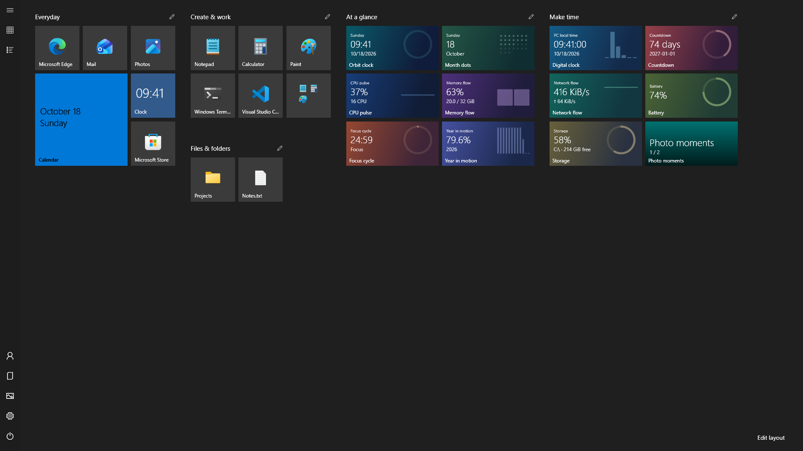

<p align="center"></p>
<h1 align="center">ReStart</h1>
<p align="center"><strong>让全屏开始菜单回归。</strong><br>你的应用、你的布局、你自己的动态磁贴。</p>

<!-- languages:start -->
[English](README.md) · [Deutsch](README.de.md) · [Español](README.es.md) · [Français](README.fr.md) · [日本語](README.ja.md) · [한국어](README.ko.md) · [简体中文](README.zh-CN.md) · [繁體中文](README.zh-TW.md)
<!-- languages:end -->

> **AI 翻译：** 本指南使用 AI 从英文翻译，可能存在错误。[英文 README](README.md) 为主要参考，包含更多示例。欢迎修正翻译。截图使用英文演示环境和示例数据。



怀念 Windows 10 的全屏开始菜单？ReStart 在 Windows 11 和 Windows 10 上为应用提供熟悉的空间。固定常用内容，自由安排布局，再加入可以用 JavaScript 编写的动态磁贴。

**便携 · JavaScript 动态磁贴 · x64 和 ARM64 · 八种语言 · 无需单独安装 .NET**

## 快速开始

1. Intel/AMD 电脑下载 **[x64 ZIP](https://github.com/LastResolution/ReStart/releases/latest/download/ReStart-win-x64.zip)**；Windows on ARM 下载 **[ARM64 ZIP](https://github.com/LastResolution/ReStart/releases/latest/download/ReStart-win-arm64.zip)**。
2. 解压**整个 ZIP**。保留 `ReStart.exe` 旁的 `TileHost`、`Examples` 和 `third-party`。
3. 运行 **ReStart.exe**，按 **Windows 键**并输入应用名称。也可以使用 **Ctrl+Alt+Space** 或托盘菜单打开。

齿轮设置中可选择主题、登录启动、Windows 键/开始按钮集成及更新。正常使用不需要管理员权限。目前下载未进行代码签名，提供 [SHA-256 校验值](https://github.com/LastResolution/ReStart/releases/latest)。

## 功能


| 类别 | 包含功能 |
| --- | --- |
| 打开和关闭 | 可选接管 Windows 键和任务栏开始按钮、Ctrl+Alt+Space、托盘控制、前台激活、切换应用/任务栏时关闭、按显示器工作区域显示、单实例 |
| 启动 | 可选登录启动、后台模式、跟随主题的准备画面和提前输入、图标缓存、后台应用目录刷新 |
| 磁贴和分组 | 四种尺寸、独立磁贴、按内容调整大小的可移动矩形分组、横向半格锚点、自动放置、双向滚动 |
| 文件夹 | 在分组内重叠创建、原位展开、添加/移除/排序、内联重命名和解散；只剩一个项目时仍保留文件夹 |
| 编辑布局 | 编辑模式、多选、批量移动、会话内撤销/重做；取消拖动保留原布局 |
| 拖动反馈 | 区分分组/文件夹目标、停留进度、可选提示及分组边界、边缘自动滚动；自动创建分组/文件夹可关闭 |
| 固定内容 | 应用、文件、目录、快捷方式、网站；资源管理器 **Pin to ReStart**、右键菜单、从应用列表拖动、明确指定目标 |
| 搜索 | 规范化应用名称、带英文别名的 15 个本地化 Windows 设置页面、可选本地索引文件名、方向键/Enter、丢弃过期查询 |
| 所有应用 | 自适应字母列、展开开始菜单目录、字母选择器、键盘导航、实时刷新安装/卸载、最近添加和可选最常使用 |
| 应用命令 | 可用的 Windows 管理员运行/文件位置/属性/卸载；根据 Windows 历史设置和 API 支持提供最近/常用文档菜单 |
| 启动选项 | 每个磁贴独立启用、参数、工作目录、受支持桌面应用/快捷方式的管理员运行；Windows 负责 UAC |
| 导航 | 可选悬停展开、单独选择文档/下载/音乐/图片/视频/网络/个人文件夹、账户和电源操作 |
| 外观 | 五种色系及各自的明暗变体、系统模式、自定义 RGB 背景/强调色、桌面壁纸、开始菜单着色、单个磁贴颜色、主题控件/滚动条、高对比度、可选动画 |
| 动态磁贴 | 15 个 JavaScript 示例、四种响应式尺寸、本地点击动作、实时更新开关、数据配置、创建示例、导入包、自动监视本地库 |
| 磁贴 API | 电脑时间、语言/尺寸、保留状态、CPU/内存/网络/电池/存储、所选照片、缓存 JSON/Web API/RSS/Atom/文件输入、本地应用集成 |
| 语言 | 英语、日语、德语、法语、西班牙语、韩语、简体中文、繁体中文，包括内置磁贴文案 |
| 数据和更新 | 本地设置、布局导入/导出/重置、备份和迁移、可清除的应用活动、版本/构建/许可证、无需 API 密钥的更新检查和手动安装 |
| 分发 | Windows 10/11 x64 和 ARM64 便携包、内含运行时和声明、可逆集成、不修改 Explorer |

[开关与默认值（英文）](docs/start-behavior.md) · [兼容性（英文）](docs/fidelity.md)

## 搜索与配置


在 **Settings → Start behavior** 中分别关闭设置/文件搜索、文档菜单、悬停效果、自动分组/文件夹、边缘滚动、拖动提示。最常使用应用的记录默认关闭。

| 开始菜单行为 | 每个磁贴的启动选项 |
| --- | --- |
|  |  |

关闭 **Use custom launch options** 时仍保留填写内容。未启用时，快捷方式保持 Windows 的常规启动设置。

## 动态磁贴与数据


- **时间与专注：** Orbit clock、Digital clock、Month dots、Focus cycle、Year in motion、Countdown。
- **电脑：** CPU pulse、Memory flow、Network flow、Battery、Storage。
- **照片：** Photo moments，选择文件夹，点击切换下一张。
- **连接数据：** Weather、Feed headlines、JSON monitor。

右键背景 → **Add live tile**。点击执行磁贴本地动作，例如暂停计时或切换照片。Weather/Feed/JSON 在 **Configure data sources…** 中填写网址或选择文件并保存。**Refresh data now** 可请求最新数据。

**天气初始使用柏林示例坐标，不是电脑的位置。** ReStart 不推测你的地区。请按[天气指南](docs/javascript-tiles.md#weather-location)修改坐标和显示名称。凭据按当前 Windows 用户加密并排除在布局导出之外。连接失败时可显示缓存；隐藏开始菜单后停止读取。

自定义磁贴由 `manifest.json` 和 `tile.js` 组成。`render(ctx)` 接收有界的数据快照并返回原生显示数据，可按尺寸改变布局。JavaScript 没有通用文件、网络或 CLR 访问权限。把包文件夹放入 `%LOCALAPPDATA%\ReStart\TileLibrary` 即可自动发现。[示例](examples/tiles) · [JavaScript API（英文）](docs/javascript-tiles.md) · [本地数据生成示例](examples/integrations/write-tile-data.ps1)

## 操作

| 操作 | 结果 |
| --- | --- |
| Windows 键 / `Ctrl+Alt+Space` | 打开或关闭 |
| 输入 / `Ctrl+F` | 搜索；Enter 启动高亮结果，方向键更改选择 |
| `Esc` | 依次关闭搜索、文件夹或叠加层，再关闭开始菜单 |
| 拖动磁贴 / 分组标题 | 移动；放到空白处创建独立磁贴 |
| 在独立磁贴上部分重叠约 0.3 秒 | 预览就绪后创建普通分组 |
| 在分组内磁贴上重叠约 0.6 秒 | 创建文件夹；已有文件夹接收添加项 |
| **Edit layout** / `Ctrl+E` | 多选而不误启动应用 |
| 编辑时 `Ctrl+A` / `Delete` | 选择根磁贴 / 取消固定所选项 |
| `Ctrl+Z` / `Ctrl+Y` 或 `Ctrl+Shift+Z` | 撤销 / 重做布局 |
| 铅笔 / 双击名称 | 内联重命名分组或文件夹 |
| `Shift` + 滚轮 | 横向滚动 |

Windows 组合键会转发给系统。布局历史在会话内保留最多 100 次修改、占用不超过 32 MiB；文本框保留自身的文本撤销。再次打开会回到固定磁贴主界面。

## 设置、隐私和更新

设置位于 `%LOCALAPPDATA%\ReStart\layout.json`。可选应用活动单独保存在 `activity.json`，可以清除。迁移保留备份，参见[说明（英文）](docs/migration.md)。About 显示版本、构建和许可证。

更新检查读取公开 GitHub Releases，无需 API 密钥。退出 ReStart 后手动替换完整解压安装目录。位置改变时重新保存启动注册和资源管理器集成。没有广告或使用分析，不上传应用列表、布局或照片选择。配置的数据提供方会收到相应请求。[安全（英文）](SECURITY.md)

卸载时关闭登录启动和资源管理器集成，从托盘退出并删除安装目录。只有同时想删除设置和自定义磁贴时才删除本地数据目录。

## 自行构建

使用 Windows 和 `global.json` 选择的稳定版 [.NET 10 SDK](https://dotnet.microsoft.com/download/dotnet/10.0)。替换文件前先退出正在运行的应用。

```powershell
git clone https://github.com/LastResolution/ReStart.git
cd ReStart
dotnet restore ReStart.slnx --locked-mode
dotnet build ReStart.slnx -c Release --no-restore
dotnet test ReStart.slnx -c Release --no-build
.\src\ReStart.App\bin\Release\net10.0-windows\ReStart.exe
# 隔离预览：
dotnet run --project src/ReStart.App -c Release -- --preview
# 内含运行时的便携包：
./scripts/package.ps1 -Runtime win-x64
```

ARM64 使用 `win-arm64`。ZIP 和校验文件生成在 `artifacts/packages`。请始终分发完整 ZIP。

[问题与建议](https://github.com/LastResolution/ReStart/issues/new/choose) · [参与贡献（英文）](CONTRIBUTING.md) · [架构（英文）](docs/architecture.md) · [测试（英文）](docs/testing.md) · [发布](https://github.com/LastResolution/ReStart/releases)

ReStart 是受后期 Windows 10 全屏开始菜单启发的独立 MIT 项目，与 Microsoft 无关联。图像展示真实应用的英文演示、合成指标和生成的照片色块。名称和图标归各权利人所有。[MIT 许可证](LICENSE) · [支持（英文）](SUPPORT.md)
