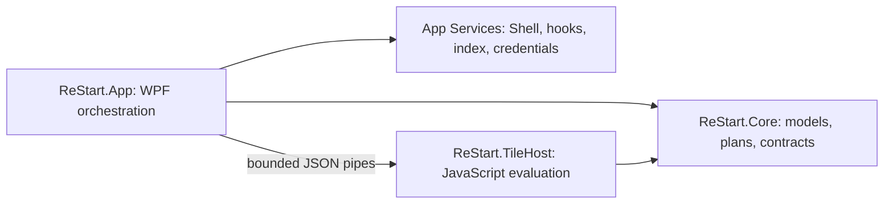

# Architecture

ReStart is a WPF desktop launcher. It owns its layout, search and live-tile protocol; it does not replace Explorer binaries.

## Components

| Project | Responsibility |
| --- | --- |
| `ReStart.Core` | Models, tile/group geometry, layout mutations, search, localization, persistence, release parsing and input state |
| `ReStart.App` | WPF views, shell catalog/commands, hooks, tray, settings, update checks and worker/browser lifetime and Tile Studio |
| `ReStart.TileHost` | Jint worker exchanging bounded JSON messages |
| `ReStart.Core.Tests` | Domain invariants, persistence recovery, update feeds and isolated Windows integration tests |
| `scripts` / `.github` | Native fixtures, portable packages, CI and releases |

Most Core logic is independent of WPF. Windows-only synchronization and test-linked services declare their platform requirements.

## Source organization

The project roots keep entry points, project configuration and global imports. Feature code lives with its responsibility:

| Location | Contents |
| --- | --- |
| `ReStart.Core/Apps`, `Search` | Catalog identities, pinning/activity models, app matching and indexed-query construction |
| `ReStart.Core/Layout` | Tile/group models, geometry, folder expansion, editing, history, persistence and migration |
| `ReStart.Core/Configuration`, `Appearance`, `Localization` | Preferences, palettes and translated text; locale JSON remains in `Locales` |
| `ReStart.Core/LiveTiles`, `Updates`, `Windows` | Bounded tile/data contracts, public release parsing, input state and current-user instance/IPC coordination |
| `ReStart.Core/Diagnostics`, `ReStart.App/Lifecycle` | Whitelist-only shareable reports; update-specific startup, handoff and acknowledgment before normal shell integration |
| `ReStart.App/Views` | `Start`, `Settings`, `Startup` and `Dialogs`; each XAML/code-behind pair stays together |
| `ReStart.App/Controls`, `Resources`, `Localization` | Reusable WPF controls, themed dictionaries and the localization markup extension |
| `ReStart.App/Services` | `Catalog`, `Search`, `Shell`, `LiveTiles` and `Configuration`; native calls and process effects live here |
| `ReStart.App/Diagnostics` | Native verification partials and isolated `Documentation` rendering; these are not UI feature services |
| `tests/ReStart.Core.Tests` | Matching feature folders, including explicit Windows process/integration coverage |

Shared model declarations have individual files, including `AppEntry`, `Tile`, `Preferences` and `LayoutDocument`. Existing namespaces and serialized types are preserved. Folder placement helps navigation; shared-state partials still belong to one class, and the ownership boundaries below remain the guide for extracting services. The architecture guard prevents feature files from accumulating in the project roots again.

The App-to-TileHost project reference is a **build dependency only** (`ReferenceOutputAssembly=false`); the UI never invokes the worker's Jint engine in-process. Core references neither UI nor worker. The existing test project also links selected Windows services for process-level checks; these are explicitly Windows-gated rather than evidence that all tests are portable.

## Ownership and change boundaries

| State / effect | Owner | Boundary |
| --- | --- | --- |
| Persistent layout and preferences | `LayoutDocument` / `LayoutStore` | Atomic writes and schema migration; WPF geometry is never persisted |
| Portable updates | Core package/download/transaction code and App `PortableUpdates` | Fixed download source, inventory-owned replacements, separate helper lifetime, durable rollback and startup acknowledgment; no user-file enumeration |
| Placement, folder and batch plans | Core planning types | Calculate from snapshots; preview and commit share results; cancellation does not mutate ownership |
| Selection, popup/focus and drag lifetime | MainWindow interaction partials | Dispatcher-owned; callbacks revalidate visibility and current generation |
| Search request lifetime | MainWindow search orchestration | Immediate apps/settings, debounced indexed files, cancellation and stale-query rejection; Windows COM remains in a service |
| Catalog and icons | `AppCatalog` | Dedicated STA enumeration; completed snapshots and frozen images cross to UI |
| Launch and Jump List effects | `AppShellCommands` / `AppJumpLists` | Canonical verbs and documented COM; never evaluate translated menu text |
| Optional app activity | `AppActivity` / App persistence | Bounded local state; separate from exported layout and Windows document history |
| Script processes and data reads | App worker pool / data services | Parent owns cancellation, limits and process lifetime; worker sees bounded snapshots |
| Documentation images | Dedicated render entry point | English curated fixtures, no visible windows or real settings; matched installed icons, not an exported app inventory |

`MainWindow` is still a substantial WPF coordinator. Its partial files are **not** separate architectural modules: they share private state. Keep pure layout rules in Core and new native effects in services. The next extractions are explicit:

1. Move catalog/startup orchestration into a lifetime-owned coordinator once its cancellation and typeahead contracts can move together; retain native focus at the window boundary.
2. Extract a search session with immutable categorized results and injectable providers, keeping WPF row focus/selection rendering in the view. Preserve identity across late results.
3. Extract the script/data session registry as one disposable owner, then narrow the window to applying returned frames. Preserve hide/startup/exit cancellation semantics.
4. Split native services into a Windows adapter project when another frontend or independent integration tests justify it; do not move Shell dependencies into Core.

Each extraction must retain the existing native startup, focus, drag, folder, history and script regression checks. A complete MVVM rewrite or a new plugin system is not part of this change. This is a migration plan grounded in the present code, not a claim that those extractions are already complete. Project dependency checks enforce the current direction in CI.

## Placement and editing

`TileLayout` reserves explicit cells before packing unplaced or colliding tiles. The four footprints are 1×1, 2×2, 4×2 and 4×4. Layout calculations do not mutate input models.

`GroupLayout` stores group columns and vertical anchors in half-cell steps. Groups retain independent positions and gaps; only intersecting bounds are displaced. A new X anchor stores horizontal logical cells; wide boards retain their positions and scroll rather than rewriting them on narrow screens. Preview and commit use the same calculation, preserving each tile's identity, size and internal coordinates.

A schema-4 `TileGroup.IsStandalone` entry stores exactly one independent tile. It renders without a group header/menu and occupies only that tile's width and height. Its tile column supplies the offset inside the board column; its vertical anchor belongs to the board. This is an explicit ReStart extension requested for detached tiles, not a claim about Windows 10's internal model. Ordinary groups measure occupied content; the configured 6/8 cells limit internal wrapping. Group X anchors snap in half-cell steps.

`GroupBoardPanel` uses the same rectangles for measure and arrange. `LayoutEditor.Detach` freezes visible anchors and moves ownership once. `FolderExpansion` adds temporary inline content without changing saved root rows. Its width is the maximum occupied edge of root and child placements, shared by Core collision bounds and WPF measurement; the configured wrap limit is not an empty minimum width. Expanded independent folders keep the root tile's horizontal position. Only groups that actually intersect the expanded footprint are displaced, and closing restores the saved baseline.

`LayoutHistory` retains deep snapshots of groups and one-level children only, bounded to 100 edits and 32 MiB. Successful writes record one operation; identical saves retain redo. Editing after undo drops the redo branch. Preferences, upgrade metadata, live-script runtime state and external files remain outside history. Undo/redo persists through the same atomic store and restores its cursor if writing fails. History lives only in memory and survives hiding Start, not process exit.

Edit mode suppresses tile activation and uses stable IDs for selection across redraws and history restoration. Folder parents and children cannot be selected together. `TileBatchMove.Plan` copies the layout, freezes existing anchors, validates a rigid selection and reserves selected cells before reflowing conflicts. Open-space moves create one unnamed group by default, or reserve independent entries when the drag requests free placement. Invalid and cancelled plans leave the source unchanged; preview and commit share the plan. A one-entry cache avoids recomputing the same snapped destination. The group menu explicitly compacts selected tiles; dragging preserves their relative positions.

Drop routing distinguishes group cells, expanded folder children, tile-over-tile folders, and empty board space. Empty-space drops create unnamed groups by default; `PinOnBoard` uses the same persisted `FreeTilePlacement` preference for new app/custom pins. Alt overrides an empty-space drag without persisting the preference. Shift suppresses overlap intent, so selected destination cells displace neighbors rather than creating or entering folders. Native defaults also apply over retained legacy independent entries. Single tiles and non-folder selections can create folders; nested folders are rejected. A one-child folder remains a folder until its last child is removed.

The optional free-mode overlap gesture uses `TileGrouping.Plan` to collect independent roots into an ordinary group. Its copied plan reserves earlier neighbors before placing a new header. This compatibility extension is inactive in native mode; merely holding Alt does not enable it. Loading schema 4 never converts existing entries or folder children.
Optional free-mode independent grouping starts at 40% overlap of the smaller tile area and arms after 300 ms. A tracked target stays eligible down to 30% overlap so small pointer drift does not restart the timer. Leaving that tolerance resets the dwell. Folder creation/addition uses 65% entry overlap, 55% retained overlap and a 600 ms dwell. These are ReStart interaction choices, not measured Windows shell constants.

Single-tile preview and commit share one resolver. Root overlap also resolves compact independent targets whose bounds do not contain a larger dragged tile's center. During OLE dragging, the dwell timer retains the latest drag-event position in viewport coordinates and reprojects it after scrolling. It does not poll WPF's mouse device, which can still report the original grab position while OLE owns pointer tracking. Leaving the content or ending/cancelling a drag retires the timer.

`PlacementTransitions` owns layout-neutral translation clocks, retains press transforms and retargets from current displayed offsets with a 200 ms cubic ease-out. `MainWindow.PlacementMotion` maps old/new stable IDs across commits and group layout changes. Logical origins are computed without render transforms, so animation cannot redirect a hover. Identical snapped plans are cached and do not restart clocks or rebuild views. Reduced motion settles offsets immediately; hide/rebuild cancels retained clocks. Documentation rendering uses paused controllable clocks and a synthetic frame time rather than encoder wall time.

The drag ghost and time-based edge scrolling share a session-scoped `CompositionTarget.Rendering` subscription. Native cursor coordinates are read once per frame, and a retained translation moves the ghost without Canvas layout invalidation. Alt/Shift changes refresh a stationary pointer proposal, including when edge scrolling is disabled. End/cancel/hide/exit removes the static event subscription.

## Catalog and shell

`AppCatalog` enumerates AppsFolder and user/common Start-menu .lnk/.url files on dedicated STA threads. User entries win for equal relative paths. SHGetFileInfo supplies localized display names; directory paths remain available for `AppListTree`.

`AppCatalogLayout` matches explicit AUMIDs, unique target-plus-argument identities, then unambiguous names. It preserves existing shell IDs and keeps ambiguous shortcuts distinct. Icons are obtained with IShellItemImageFactory using ICONONLY and SCALEUP, avoiding miniature folder/document thumbnail badges. Images are frozen for WPF sharing and native handles are released.

App directories expand inline. Column balancing keeps headings and initial children together. Search uses the flat catalog, including closed directories. Input preferences are applied before catalog loading; completing the catalog reruns any pending query without taking navigation focus.

Four independent STA workers load icons into frozen images. `IconCache` stores PNG pixels under SHA-256 identities in the user's local data folder, with a one-day refresh, file length/write-time invalidation and a 1,024-entry bound. Damaged or inaccessible cache entries fall back to the Shell. No source paths or app-name index are stored in the cache; deleting it is safe. Catalog/icon refreshes rebuild the board twice during initialization rather than once per icon batch.

Each icon worker explicitly initializes COM. If the 64-pixel image factory cannot return a filesystem icon, the [SHGetFileInfo full-icon API](https://learn.microsoft.com/en-us/windows/win32/api/shellapi/nf-shellapi-shgetfileinfow) supplies a fallback; its native icon handle is released after copying the pixels.

Search results use native ListBox selection. The first result is highlighted while the native TextBox retains its caret; arrows move row focus and selection, and Enter invokes the selected rendered action. A same-query refresh retains the selected app identity even if ranking changes.

The catalog is refreshed asynchronously on reopening with a five-second coalescing interval, and after thirty seconds while visible. Concurrent refresh requests share a task. A failed enumeration retains the last successful snapshot. Refresh waits for drags, inline edits and dialogs before replacing rows, preserves the selected installed app and never deletes user pins. Start-menu folder paths are published as one completed dictionary rather than cleared during enumeration. Only icon pixels are cached on disk; the application list is an in-memory snapshot.

`AppShellCommands` reads IContextMenu canonical verbs on an STA and displays supported enabled commands. Invocation re-queries the command ID. Preview never invokes them. App launch targets are passed as shell identities or individual arguments, not evaluated as shell command text.

## Lifetime and input

A per-user/session mutex prevents duplicate normal instances across versions and paths. A named event activates the existing instance. Preview has a separate scope. Background duplicate launches do not open the menu.

The initial foreground presentation uses `StartupWindow` while catalog, icons and initial tile frames are prepared. It displays the shared app logo, progress and Cancel, without a search field. A clipped native TextBox preserves typeahead and IME composition; the query and an optional Enter intent transfer to the prepared launcher. Worker startup overlaps icon loading. Missing initial frames receive bounded retries without rerendering every healthy tile during data waits. The regular script timer yields to startup preparation. Hidden content is measured before script bounds are sent, and chosen photos/system-rate samples are allowed to settle. External data and failed scripts produce bounded loading/error states rather than blocking Start indefinitely. Esc, a second toggle, taskbar dismissal or deactivation cancels presentation without a later unsolicited popup. Sign-in background initialization shows no splash and executes no tile scripts or data reads until Start is requested. Subsequent presentations reuse loaded icons and cached frames.

Low-level hooks run a short Win32 message loop on a dedicated thread. A bare Windows key toggles ReStart; combinations replay the pending Windows-key down. UI work is dispatched. Hooks, hotkeys and workers are released on exit. Native Start-button capture uses recent UI Automation bounds scoped to Explorer's primary/secondary taskbars; no DLL injection or guessed hit regions are used.

While Start is visible and close-on-deactivation is enabled, an out-of-context `EVENT_SYSTEM_FOREGROUND` subscription observes subsequent activations even if a taskbar thumbnail already deactivated WPF. The callback rechecks the current window, ownership, visibility generation and event time before dismissing. Owned dialogs and transient taskbar/menu surfaces are excluded; taskbar thumbnail clicks also use the click-dismiss path. Observation is unregistered when hidden, disabled or disposed. Dialog and drag guards still apply.

Sign-in startup manages one current-user Run value, reconciles its actual state, and restores it if settings saving fails.

## Persistence, updates and credentials

Schema 4 stores tiles, preferences, independent entries, producer version and the last upgrade record. Schemas 1–3 migrate on load; their original bytes are preserved before the first new save. Same-schema application upgrades also receive durable backups. Normal writes use a temporary file and File.Replace with a rotating .bak. Future schemas or newer producer versions are read-only. See [migration](migration.md).

`ReleaseClient` validates bounded public GitHub release pages, semantic versions and architecture-matching ZIP/checksum pairs. The app owns a timeout-limited HTTP client with redirects disabled. Checks are single-flight, canceled at exit and disabled in preview. No update credentials are accepted or sent. See [updates](updates.md).

## Rendering and resources

The native window uses the pointer monitor's working area and PerMonitorV2. WPF content uses DIPs and logical cells. The wallpaper blur is an approximation of the original composition.

The platform fixture checks actual connected-monitor working areas and native/WPF DPI agreement without registering production integration or reading a user catalog. Its default host remains hidden; an explicit visible mode exercises the launcher HWND. Both use the production `MonitorPlacement` helper, which lets WPF process DPI changes before coalescing a physical working-area correction. Recorded two-display runs cover 100%/125%/150% scaling and a mixed portrait/landscape configuration. UI Automation provider checks cover navigation, app tiles and selected search results separately from actual Narrator recap checks; see [observed coverage](fidelity.md#observed-platform-coverage).

Theme resources cover controls, scrollbars, dialogs and calendar. High contrast overrides effects. Modern app tiles use uniform translucent plates; Classic tiles share a global accent. Explicit per-tile color overrides are a ReStart extension and can be reset; high contrast still wins. Optional Start-surface accent applies to dark mode.

Five color families each provide light and dark palettes, selected independently of the base mode. The optional local `ColorThemeId` selects a family (null/missing marks legacy RGB, empty marks intentional custom RGB); System resolves it against the current Windows shell mode without rewriting stored RGB fallback values. Exact legacy RGB palettes are recognized when opening Settings, while ordinary loading preserves them. Editing either RGB field leaves the family and retains custom values across mode changes. Reset/default colors clear the family identity and classic Start-accent flag. An empty background retains the previous base-theme behavior; a custom background derives light/dark text, control surfaces and title-bar treatment from its luminance. Muted text, focus indicators and scrollbars retain readable contrast, and filled accent actions choose black or white ink. The same dynamic resources cover the splash, expanded navigation and settings. Color drafts are validated before saving; preset selection and arbitrary RGB fields remain local preferences, outside layout undo/redo. These color themes are ReStart extensions.

Expanded navigation uses the [documented MDL2 glyph mapping](https://learn.microsoft.com/en-us/windows/apps/design/iconography/segoe-ui-symbol-font), including AllApps (E71D), through `RailLabel`: a fixed-width Segoe MDL2 Assets icon column and a separate localized caption. Accessibility names belong to each action and do not depend on decorative Unicode symbols in translated text.

Typed `TextKey` references resolve eight embedded JSON catalogs. Custom labels and OS app names are preserved; default live-tile titles resolve in the selected language. Public/protected APIs require XML documentation; CS1591 is a build error.

## JavaScript boundary

Visible live tiles share four workers, a fresh Jint realm per render, and bounded JSON input/output over current-user-only asynchronous named pipes. The parent enforces a timeout independently of pipe cancellation and owns resource-limited Job Objects. Hiding Start retires workers; successful JSON state survives hiding but resets on reload/exit. Capability-gated host samplers and selected-folder images never expose general file/network APIs. A watched library discovers metadata without executing sources. This is process isolation, not an OS privilege sandbox. See [the API guide](javascript-tiles.md).

The optional data.sources path is owned by the UI host, outside Jint: TileDataTransport shares four bounded asynchronous read slots; TileDataSource coalesces requests, revalidates, backs off and retains the last good snapshot. ScriptDataRuntime adapts named inputs to JSON context and cancels them when hidden. ScriptDataBindings encrypts explicit connections with current-user DPAPI in data-bindings.dat. Import/export never transfers those bindings. No JS-provided runtime URL is accepted and no response triggers shell execution.

## Web tiles and authoring

Version 2 packages use `HtmlTileView`, backed by WebView2 composition controls so browser surfaces remain inside WPF selection, drag, clipping and focus visuals. Views are cached by tile ID across board redraws, reparented on the dispatcher, suspended on hide and disposed on retirement. Each has a generated HTTPS origin; a resource handler serves explicit in-memory package files/assets and an optional opaque image. It never maps the installed folder. A JSON message bridge delivers context/state and optional synthetic clicks; no CLR/OS object is exposed. Declared direct networking also needs an installed-tile grant. Imports retain only grants already present for matching local tile/package IDs.

Native version 1 packages continue through the isolated worker pool. Scheduling tracks each tile independently: an awaiting tile does not prevent another due tile from updating. A short dispatcher poll avoids missing a one-second deadline by a few milliseconds. Browser clocks/Canvas may animate locally between snapshots; the Orbit dial reads PC wall time rather than an old queued snapshot, and respects reduced motion.

Tile Studio owns source editors, offline sample context and four preview sessions. Web previews always disable direct networking and never read saved bindings or user files. Library and installed saves validate UTF-8 limits and replace a manifest last with rollback, preserving stable installed IDs and host bindings. The package owns HTML/CSS; the host owns tile footprint, selection and integration.

Global/group placement locks are preferences outside undo history. Core planning checks effective geometry and membership before committing; keyboard editing and drag/drop share the persistence gate. Separate backgrounds are decoded into managed GUID-named PNGs, without storing their original paths. Account pictures come from read-only Windows account metadata, with glyph fallback; synthetic preview mode never reads them. A session whose persisted layout is externally deleted cannot silently recreate it on exit.

## Settings presentation and update readiness

`SettingsWindow.Preview` owns a detached preferences draft, preview debounce, close decisions and per-content listener cleanup. `MainWindow.SettingsPreview` exposes those values only through `DisplayPreferences` to visual consumers. The committed `Document.Preferences` remains the source for persistence, shell integration and startup behavior. Saving clones the draft; discarding removes the overlay, so later layout saves cannot capture abandoned appearance or language changes. Language rebuilds dispose old library watchers and update subscriptions before replacing controls.

`PortableUpdates.Prepared` keeps a bounded installation-specific index of an explicitly downloaded workspace. It restores readiness only after revalidating both inventories, payload/helper hashes, version, architecture and workspace ancestry. The handoff refreshes the current PID/creation time and still requires explicit restart consent. A persistent nonmodal reminder represents readiness; ordinary process startup does not apply a staged update.
