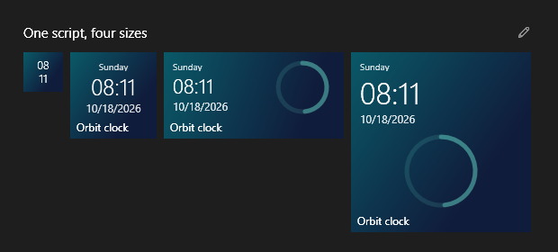

# JavaScript live tiles


Right-click the background or a group → Add live tile, or open Settings → JavaScript tiles, to choose nineteen ready-to-use packages. Adding one does not open a code editor. Connected tiles open native connection settings; no requests start until you save an enabled connection. Normal clicks send a local event; right-click to edit JS/settings, reload, configure data or select a photo folder. Tile Studio is the built-in authoring workspace for HTML, CSS, JavaScript and the manifest. Its offline sample input and four size previews let you experiment before saving or pinning.

| Package | Display / click |
| --- | --- |
| orbit | Local clock and seconds ring / toggle seconds |
| calendar | Day and month-progress dots |
| cpu | CPU history / processor count or uptime |
| memory | Physical memory history / free or used detail |
| focus | Focus/break countdown / pause or resume |
| year | Year progress and month bars |
| clock | PC time / 12- or 24-hour format |
| countdown | Days to an ISO target or next New Year |
| network | Receive/send rate history / change direction |
| battery | Charge and charging state |
| storage | Used/free capacity / next fixed drive |
| slideshow | Selected-folder photos / next image |
| weather | Open-Meteo temperature and conditions for configured coordinates |
| feed | RSS/Atom headlines / next headline |
| json-monitor | A Web API or selected local JSON file, with optional progress |

## HTML, CSS and browser JavaScript

Bundled packages use **version 2** with `"renderer": "web"`. Each has `manifest.json`, `tile.js`, `index.html` and `tile.css`; an optional `assets/` directory holds local images, fonts, modules or other resources. Import copies these resources into a generated installed package. Connection files are never imported. Version 1 native JavaScript packages continue to work.

HTML tiles require Microsoft's [WebView2 Runtime](https://developer.microsoft.com/microsoft-edge/webview2/). If it is missing, ReStart shows an actionable error instead of installing software silently. The browser SDK is included; the browser runtime is maintained separately by Microsoft.

```json
{
  "version": 2,
  "renderer": "web",
  "title": "My canvas",
  "refreshSeconds": 1,
  "settings": {}
}
```

```html
<!doctype html>
<html><head><link rel="stylesheet" href="/tile.css"></head>
<body><main><strong id="value"></strong>
<span data-restart-title id="name"></span></main>
<script src="/tile.js"></script></body></html>
```

```css
html, body { width: 100%; height: 100%; margin: 0; background: transparent; }
main { box-sizing: border-box; height: 100%; padding: 10px; display: grid; }
#value { align-self: center; font: 28px 'Segoe UI', sans-serif; }
[data-size="small"] #value { font-size: 14px; }
```

```js
function render(ctx) {
  document.getElementById('value').textContent =
    new Date(ctx.now).toLocaleTimeString(ctx.locale);
  document.getElementById('name').textContent = ctx.title;
}
```

The tile keeps its small, medium, wide or large footprint. Inside it, use ordinary DOM, CSS, SVG, Canvas, responsive layout and browser JavaScript. Transparent corners and backgrounds are supported. The host sets `data-size`, `data-show-title`, `lang` and `--tile-scale` on the document root before each update. It supplies actual bounds in DIPs; do not assume a fixed device pixel ratio.

`render(ctx)` may be synchronous or asynchronous and may update the DOM directly. An optional `present(result, ctx)` runs afterward, useful for separating data from presentation. A web tile does not need to return native display fields. `window.ReStart` offers:

| API | Meaning |
| --- | --- |
| `ReStart.context` | Latest JSON host context; no filesystem handles or host objects |
| `ReStart.onUpdate(fn)` | Subscribe to updates; the returned function removes the subscription |
| `ReStart.setState(value)` | Set JSON session state, up to 8,192 UTF-16 units; it resets on reload or exit |
| `ReStart.imageUrl` | Opaque same-origin URL for the selected slideshow image, or `null`; no source path is exposed |

`ctx.theme` supplies `mode`, `highContrast`, `reducedMotion`, `accent` and an optional user `customColor`. `ctx.appearance.showTitle` reflects **Settings → JavaScript tiles → Show live tile names**, initially on. Mark a name with `data-restart-title` so the host can hide it; custom layouts can also use the context and root data attribute. Titles remain available to tooltips and accessibility when visually hidden. This setting applies to live tile names, not ordinary app labels.

Normal tile clicks deliver `ctx.event`, dispatch `restart:click`, and forward a synthetic DOM click at the pointer position (or tile center for keyboard activation). These are not trusted browser input events; permission-gated browser actions remain unavailable. Edit mode selects tiles instead of interacting with their content.

The Orbit sample paints its SVG hands from the PC's `Date.now()` at up to 30 fps while visible. It does not wait for a host refresh or contact an internet time service. Reduced motion uses discrete host updates. Synthetic documentation contexts set `ctx.time.preview` to keep captures reproducible. Other examples can use `requestAnimationFrame` for local animation; respect `ctx.theme.reducedMotion`, pause unnecessary work, and use host snapshots for metrics or configured data.

### Distinct web examples

| Package | What it demonstrates |
| --- | --- |
| `orbit` | Transparent surface, real circular SVG dial, PC-time hands and theme-aware text |
| `weather-scene` | CSS sun/cloud/rain artwork driven by an explicitly configured weather response |
| `system-dashboard` | Multiple CSS conic gauges, CPU/memory values and a network activity strip |
| `news-board` | Responsive editorial typography and a click-through RSS/Atom card |
| `canvas-garden` | Canvas line art, session color changes and optional local animation; no audio or network input |

The other fourteen packages also include editable HTML/CSS. All nineteen packages have localized names and labels in eight languages. Weather examples suggest Berlin coordinates until changed; they do not discover your location. Animated weather artwork and the garden honor reduced motion.

### Tile Studio

Open **Tile Studio** from settings, the **Add live tile** menu, or an installed tile's context menu. Choose a template, edit HTML/CSS/JS/manifest, and preview all four sizes. **Ctrl+Enter** previews and **Ctrl+S** saves. Automatic preview is optional. Click a preview to test a local action. Sample JSON is held only in the editing session: Studio does not read saved credentials, chosen files, photo folders or data connections, and direct networking stays disabled.

The editor highlights JavaScript, HTML, CSS and JSON in both light and dark themes. **Tab** indents and **Shift+Tab** outdents the current selection using four spaces. **Format document** or **Ctrl+Shift+F** formats the active editable file with a bundled, offline Prettier formatter. Formatting parses source as data without executing the tile, preserves the caret, and is one undoable edit. It does not save the file. Invalid syntax leaves the original source intact; completion and language-server suggestions are not included.

**Save to tile library** creates or updates one draft. **Save and pin** validates the preview and installs a separate copy without moving existing tiles. Editing an installed tile updates that package in place, retaining its ID, position and host bindings. If source files were deleted, Studio explains the repair before saving a replacement template. Back up a custom package before deleting app data.

Installed packages are editable copies. An application update supplies the new bundled templates without overwriting those copies. Add a fresh bundled tile to try an updated example, or copy the desired changes into your installed package and reload it. Resetting the layout installs the current bundled Month dots and Orbit clock alongside locally discovered apps; it does not depend on a maintainer's app list.

### Scrolling and folder previews

Use `overflow: auto` or `overflow: scroll` on a bounded element for readable long content. The Feed headlines and News board packages keep their heading and optional tile name fixed while the story area scrolls. Mark one primary reading area with `data-restart-scroll` to route a wheel gesture elsewhere on the tile to that area. **Shift+wheel** scrolls horizontally; **Page Up/Down** scroll a focused tile. A scrollable tile retains its wheel gesture at either edge, so it does not unexpectedly move the launcher behind it. A tile without a scrollable area uses the launcher's normal scrolling.

Closed tile folders render up to four live miniatures with uniform small-size preview geometry. Opening the folder restores each child's saved size and interactive surface. Changing between the two presentations retains successful JSON state and pending local clicks; it does not change the stored layout.

### Browser boundary and resource limits

Each installed tile gets its own generated HTTPS origin. The host serves only its four package files, explicit `assets/` resources and an optional slideshow image from memory. It does not map the installation directory into the browser: host bindings and other local files are not web resources. Local assets are limited to 128 files, 4 MiB each and 16 MiB total; reparse entries are skipped. HTML/CSS are limited to 256 KiB each, manifest 16 KiB and JavaScript 64 KiB.

There are no CLR, Node, shell-launch or general filesystem host bridges. Browser dialogs, new windows, downloads, external navigation and permission requests are blocked. Browser execution uses WebView2's sandbox and separate processes; it does **not** use the legacy Jint instruction or memory budgets. The host waits up to three seconds for an update reply and surfaces failures, but this deadline is not a CPU budget for arbitrary browser scripts. Import only code you trust. Hidden views are suspended where supported and disposed on removal or exit.

Direct networking starts off. A package must declare `"web.network"` and the user must separately enable **Allow this tile to access the network** for that installed tile. Enabled browser networking follows CORS, CSP and mixed-content rules; it does not grant access to host connection credentials. For API keys, read-only local JSON and RSS, prefer the explicit `data.sources` host connection described below. Do not embed private endpoints or credentials in shared source files.

## Native package compatibility (version 1)

Import manifest.json beside tile.js. Only those two files are copied into a generated installed package. Edit the installed copy afterward. The native manifest uses version 1; title is at most 80 characters, refreshSeconds 1–3,600, settings an object of at most 8,192 UTF-16 code units. Optional localizedTitles maps supported language tags to default display names. Default names follow language changes; an explicitly renamed tile keeps its custom name.

```json
{
  "version": 1, "title": "CPU pulse", "refreshSeconds": 1,
  "capabilities": ["system.metrics"],
  "settings": { "color": "#102B46" }
}
```

```js
function render(ctx) {
  const cpu = ctx.system?.cpuPercent;
  const clicks = (ctx.state.clicks || 0) + (ctx.event?.type === "click" ? 1 : 0);
  return { kicker: "CPU", text: cpu == null ? "—" : cpu.toFixed(0) + "%",
    detail: ctx.calendar.shortDate, background: ctx.settings.color,
    backgroundEnd: "#151D38", foreground: "#FFFFFF", accent: "#70E0CB",
    visual: "ring", progress: (cpu ?? 0) / 100, state: { clicks } };
}
```

For legacy native packages, render(ctx) is synchronous and returns JSON display data. ReStart draws their bounded native visuals. The HTML/CSS renderer above uses a separate version 2 contract.

| Context | Meaning |
| --- | --- |
| now | PC local ISO time with UTC offset |
| language / locale | UI language tag / formatting culture |
| time | unixMs, monotonicMs, utc, local, offsetMinutes, Windows timeZoneId |
| calendar | Localized shortDate, weekday, month; numeric day |
| event | null or { type: "click", unixMs }; at most 16 pending events |
| size | small, medium, wide or large |
| bounds | Actual tile width/height in DIPs and the configured scale; initial dimensions can be zero before layout |
| settings / state | Manifest settings / previous successful state |
| system | Aggregate snapshot with system.metrics, otherwise null |
| slideshow | { available, count, index } with images.slideshow, otherwise null |
| data | Named cached snapshots with data.sources, otherwise null; connections and credentials are excluded |

Clocks use the PC, without internet time. Use monotonicMs (system uptime) for elapsed durations, unixMs for wall-clock dates. Date/time/time-zone changes invalidate visible frames. Hiding Start stops updates and retires workers; successful state survives reopening but resets on reload/exit. State is not persisted. The focus timer has no alarm or background notification.

## Responsive native layouts



Return a different frame for each `ctx.size`. Optional `layout` selects a bounded native arrangement; it never executes markup or CSS.

| layout | Arrangement |
| --- | --- |
| auto / overlay | Compatible default: text over a decorative chart |
| centered | Centered text, without chart decoration |
| split | Text on the left, chart in a separate right column |
| stacked | Text above a separate chart area |
| caption | Text at the bottom over a host-provided photo |

Small tiles always hide chart decoration, kicker, detail and badge. Bundled tiles additionally compact clock digits, percentages and units. Medium tiles emphasize their value; wide tiles split text/chart; large tiles show richer detail above a larger chart. Slideshow uses a bottom caption. Resizing requests a new frame with the current size and bounds.

```js
function render(ctx) {
  const small = ctx.size === "small";
  const value = ctx.system?.cpuPercent;
  return {
    layout: small || ctx.size === "medium" ? "centered"
      : ctx.size === "large" ? "stacked" : "split",
    text: value == null ? "—" : Math.round(value) + "%",
    kicker: ctx.settings.labels?.[ctx.language]?.caption || "CPU",
    detail: small ? "" : ctx.calendar.shortDate,
    visual: small ? "" : "ring", progress: (value ?? 0) / 100
  };
}
```

Use `ctx.bounds.width`, `height` and `scale` for additional content thresholds, with `ctx.size` as the initial fallback. Layouts reserve separate text/chart areas, so scripts do not need pixel coordinates. The native frame examples remain useful for compatibility; the nineteen bundled web packages use their own responsive CSS.

## Host capabilities

system.metrics exposes camel-case fields: sampledAt, cpuPercent (0–100), logicalProcessors, totalMemoryBytes, availableMemoryBytes, memoryPercent, uptimeSeconds, drives, networkReceiveBytesPerSecond, networkSendBytesPerSecond, batteryPercent and isCharging. Each drive has root, totalBytes, availableBytes and usedPercent. No process names, volume labels or file contents are exposed.

CPU uses a language-neutral Windows PDH total processor-time counter. CPU/network rates need two samples; warming/unavailable values are null. Memory is physical memory. Network sums active non-loopback/non-tunnel interfaces; virtual adapters may double-count traffic. Fixed-drive capacity is cached for about 30 seconds. Missing battery means null. Sampling runs during the requested startup preparation and while visible; it pauses when dismissed and makes no external requests.

images.slideshow supplies an opaque current image only after a native folder selection. Native scripts see availability/count/index rather than paths, filenames or pixels. Web packages can display and process the explicitly selected image through `ReStart.imageUrl`, without receiving its original path. Return image: "current". Supported immediate files: JPG/JPEG/PNG/BMP/GIF, up to 1,000 candidates, 20 MiB each, decoded to 768-pixel width; GIF is a still frame. settings.intervalSeconds is clamped to 5–3,600 (default 15). Click advances and automatic progression continues from there. Background loading closes file handles; animation enables crossfade. High contrast and custom tile colors suppress image overlays.

The folder binding is local installed host-bindings.json, never imported from a package or included in layout exports. Choose a folder again on another PC.

## Weather, feeds, Web APIs and application data

<p>  </p>

`data.sources` lets the host read explicitly configured inputs asynchronously. The host connection supplies the latest cached `ctx.data` snapshot to either renderer. Legacy native JavaScript stays synchronous; web packages may use asynchronous browser code within their separate networking rules. Network access is opt-in for each installed package, independent of update checks.

```json
{
  "version": 1, "title": "Service status", "refreshSeconds": 1,
  "capabilities": ["data.sources"],
  "dataSources": {
    "service": { "format": "json", "refreshSeconds": 60, "jsonPointer": "/status" }
  },
  "settings": {}
}
```

```js
function render(ctx) {
  const source = ctx.data?.service;
  return {
    text: source?.value?.text || (source?.status === "loading" ? "Loading…" : "Configure source"),
    detail: source?.stale ? "Showing cached data" : "",
    background: "#12344B", foreground: "#FFFFFF"
  };
}
```

Right-click the tile → **Configure data sources…**. Choose **Web API / feed** or **Local data file**, enter its address or select a file, and save. HTTP uses GET only. HTTPS and loopback HTTP (`http://localhost:8765/status`, for example) are accepted. No script can start a server, write a file or launch another application. Applications can publish JSON through an existing local endpoint or an atomically replaced file; [write-tile-data.ps1](../examples/integrations/write-tile-data.ps1) demonstrates the file route. Run it yourself, then select the resulting file in **JSON monitor**. No companion script runs automatically.

Each `dataSources` entry declares:

| Field | Contract |
| --- | --- |
| Source ID | 1–32 lower-case ASCII letters/digits/underscore/hyphen; first character a letter; at most four sources |
| format | `json` (default) or `feed` (RSS 2.0 / Atom) |
| refreshSeconds | 1–86,400; actual minimum 30 seconds for HTTP, 1 second for files |
| jsonPointer | Optional [RFC 6901](https://www.rfc-editor.org/rfc/rfc6901) selector, at most 256 characters; empty selects the root; use `~1` for `/` and `~0` for `~` |
| suggestedUrl | Optional public example URL, at most 2,048 characters; a suggestion never enables a connection |
| suggestedAccess | `http` (default) or `file`; packages cannot select a local file |

The native selector overrides the package selector. Clearing it selects the root. Prefer selecting a small object instead of sending a full API response to a worker. A feed becomes `{ title, items: [{ title, summary, url, published }] }`, with at most 20 items and plain, shortened text; XML entities/DTDs are rejected. Links are display data and are never opened by the host. The bundled feed cycles headlines on click.

`ctx.data.<id>` contains `status` (`unconfigured`, `disabled`, `loading`, `ready`, `error`), `value` (initially `null`), `updatedAt`, `checkedAt` (ISO timestamps or `null`), `stale` and `error` (`null` or `{ code, httpStatus }`). `updatedAt` records the last successful read/revalidation; `checkedAt` also advances on failure. Error codes include `http`, `network`, `timeout`, `io`, `file`, `format`, `selector`, `tooLarge`, `redirect` and `configuration`. Error text, connection addresses and credentials are not supplied. Failed updates retain the last good value and set `stale`; scripts can keep useful content visible while indicating its age.

Reads are capped at 256 KiB before parsing; JSON depth is 12. Selected values share an 8,192-unit serialized JSON budget per tile. At most four host reads run concurrently, each with an eight-second deadline after acquiring a slot. In-flight reads coalesce, ETag/Last-Modified allow HTTP revalidation, and failures back off exponentially up to an hour. **Refresh data now** bypasses the schedule, with a five-second throttle. Hiding Start cancels reads; cached values survive reopening in memory and disappear on reload/exit. Files must have an explicit absolute local path; UNC paths and direct reparse points are rejected.

Optional credentials go in the native password field, usually as `Authorization: Bearer …` or a provider-specific header such as `X-API-Key`. A blank password field keeps the saved value for the same server; changing server or selecting a file clears it. Connection-control headers and cookies cannot be configured. Requests have no ambient credentials or cookie jar, and redirects are limited to three on the same origin. Use the final URL for cross-origin feed redirects. Follow the provider's terms and polling limits.

URLs, selected paths, selectors and credentials are stored together in installed `data-bindings.dat`, encrypted with Windows DPAPI for the current user. They are not imported with a package, included in layout exports or passed to JS. Configure them again on another PC. DPAPI protects storage, not against other programs already running as the same Windows user. Never put keys or personal URLs in a shared manifest or script. A provider can still return sensitive values in its response; choose the selector and package accordingly.

### Weather location

The weather example uses **Berlin (52.52, 13.41)**, not your PC's region. ReStart does not infer location from IP or request device location. Open **Configure data sources…**, change `latitude` and `longitude` in the example URL, and keep the fields `current=temperature_2m,weather_code,wind_speed_10m` with selector `/current`. Then **Edit tile settings** → change `settings.location` to the place name, save and reload. The tile displays that name with Open-Meteo attribution. Units are Celsius and km/h. The [Open-Meteo documentation](https://open-meteo.com/en/docs) provides a coordinate/API builder; its [service terms](https://open-meteo.com/en/terms) apply, including the non-commercial conditions of the public free endpoint.

## Native styling

| Frame property | Limit |
| --- | --- |
| text / detail / badge / kicker | 256 / 512 / 16 / 48 UTF-16 units |
| background / foreground / backgroundEnd / accent | Empty or #RRGGBB; second stop creates a gradient |
| visual | Empty, ring, bars, sparkline or dots |
| series | Up to 32 finite fractions 0–1 |
| progress | Optional finite fraction 0–1; ring or plain strip |
| image | Empty or current; paths/URLs rejected |
| state | JSON up to 8,192 UTF-16 units |

Keep medium headlines short, with a dark gradient, white text and brighter accent. Bundled sources demonstrate every native style. Small tiles omit kicker/detail/badge. User-selected tile colors and high contrast take precedence.

## Legacy native runtime and shared storage

Legacy native tiles share four isolated workers; there is no eight-tile cutoff. Every render uses a fresh Jint realm, limited to 20,000 statements, recursion 32, 8 MB engine allocation and 100 ms. The parent enforces a one-second response deadline (ten seconds for cold process startup). Each worker has a 192 MB Job Object and cannot create child processes. Errors retain the last good frame and appear in the tooltip.

CLR, Node, direct filesystem/network, DOM, shell launch, callbacks, eval/string code generation and modules are unavailable. Source/manifest limits are 64/16 KiB; settings/state 8,192 UTF-16 units each, context 32,768, request/response 131,072/16,384. Resource isolation protects responsiveness, not OS privileges. Inspect packages before import. Editing explicitly opens Notepad instead of the .js association.

Normal data: %LOCALAPPDATA%\ReStart\tiles\<id>. Preview data is isolated beside its executable. Keep TileHost and Examples with the app. Layout export contains installed IDs, not JS sources or image bindings.

## My tile library

Open library folder in Settings opens %LOCALAPPDATA%\ReStart\TileLibrary. Place one package directory per tile, each containing its manifest and required source files (plus HTML/CSS and optional assets for web packages). The settings gallery watches for changes and discovers packages automatically; click to add without a file picker. Refresh tiles is also available. At most 128 immediate directories are inspected, symlink directories are skipped and invalid packages are disabled without executing them. Adding installs a separate copy in free independent space, preserving existing group rectangles and child cells.
